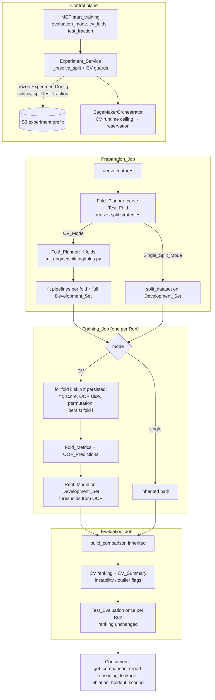

# Design Document: Cross-Validation and Test Fold

## Overview

This design adds two opt-in capabilities to ML Factory 2.0 (requirements.md):

1. **CV_Mode** — K-fold cross-validation per experiment, with the CV_Scheme derived from the
   existing split strategy (`stratified_kfold`, `kfold`, `group_kfold`, `forward_chaining`).
2. **Test_Fold** — an untouched partition carved out before CV or the single split, scored once
   by the Evaluation_Job and reported separately from the ranking metrics.

The design keeps the existing pipeline shape — preparation → one training job per model (Run)
→ evaluation — and the existing invariants: learned transforms fit on training rows only, every
number comes from the deterministic engine, artifacts are versioned Pydantic contracts with paths
only in `ml_engine/io/layout.py`, one writer per document, additive-only changes to inherited
files, nothing auto-excluded, offline default test suite.

The central choice (D3) is that **a Run stays one SageMaker Training job**. Folds run
sequentially inside it, then the Refit_Model. Each finished fold is persisted immediately, so a
Spot restart skips completed folds. The orchestrator, wave scheduling, platform caps, per-model
failure isolation and single-writer-per-run all stay as they are; only the job's runtime ceiling
(and therefore its budget reservation) grows with K.

Single_Split_Mode without a Test_Fold takes exactly the inherited code path in every stage, and
the new optional contract fields are excluded from JSON when they hold their defaults, so its
artifacts are byte-identical to those written before this feature.

### Grounding in the codebase (verified by reading the files)

| Area | Fact that shapes the design |
|---|---|
| `ml_engine/splitting/strategies.py` (adapted) | `split_dataset` + four registered strategies; `MIN_ROWS_PER_FOLD = 2`; `GroupSplit` maps missing groups to `"<missing>"`; `TemporalSplit` keeps unparseable times in training and ties on the training side. Not modified: the Test_Fold carve-out *reuses* these strategies. |
| `jobs/preprocessing/main.py` (hash-tracked) | Derives features, `plan_columns` on the frame, splits, fits one `FeaturePipeline` per strategy on the train fold, writes `train.parquet`/`validation.parquet` (`index=False`) and `PreparationReport`. |
| `jobs/training/main.py` (adapted) | One model per job; `train_model` (inherited core) needs a fitted pipeline + train/validation frames; writes thresholds, permutation importance, model, then `metadata.json` (its existence = success for evaluation). |
| `ml_engine/training/runner.py` (hash-tracked) | `train_model(..., compute_train_metrics=...)` returns `(ModelMetadata, estimator)`. Reused unchanged for every fold fit and the refit. |
| `jobs/training/checkpointing.py` (new) | XGBoost/CatBoost checkpoints in one directory. A per-fold sub-directory is required, otherwise fold 2 would resume fold 1's booster. |
| Plugins | No plugin uses early stopping today (no `early_stopping`/`best_iteration` anywhere), so Req 8.4 is recorded as "not applicable" until one does. |
| `jobs/evaluation/main.py` (hash-tracked) + `ml_engine/reporting/comparison.py` (hash-tracked) | `build_comparison` ranks by `metadata.metrics[primary]`, stable sort, no tie-break. |
| `backend/orchestration/sagemaker.py` | Budget reservation = rate × instances × `MaxRuntimeInSeconds`, reserved for the whole workflow in `_open` before the first submission; `_plan_from` rebuilds plans from the stored `ComputeSpec`. |
| `ml_engine/io/object_store.py` | `write_model` dumps every field (`model_dump_json`), so a new optional field would change single-split bytes unless excluded at its default. |
| `pyproject.toml` | `hypothesis` is **not** installed; the dev extra pins exact versions. |

## Architecture



### Stage data flow

| Stage | Reads | Writes (all paths from `ExperimentLayout`) |
|---|---|---|
| Experiment_Service | `TrainingRequest`, Settings | `config/experiment_config.json` (with `split.evaluation_mode`, `split.cv`, `split.test_fraction`) |
| Preparation_Job, CV_Mode | config, dataset, EDA | `validation/fold_assignment.json`, `datasets/development.parquet`, `datasets/test.parquet` (if Test_Fold), `preprocessing/preprocessor_{s}.joblib` (fit on Development_Set), `preprocessing/folds/fold_{i}/preprocessor_{s}.joblib`, `validation/validation.json` |
| Preparation_Job, single + Test_Fold | same | `validation/fold_assignment.json` (K = 0), `datasets/test.parquet`, inherited `train.parquet`/`validation.parquet` (split of the Development_Set), inherited preprocessors |
| Training_Job, CV_Mode | config, assignment, `development.parquet`, fold + full preprocessors | `models/{m}/cv/folds/fold_{i}.json`, `models/{m}/cv/folds/fold_{i}_oof.parquet` (as each fold finishes), `models/{m}/cv/fold_metrics.json`, `models/{m}/cv/oof.parquet` + `oof.json`, `models/{m}/thresholds.json` (from OOF), `models/{m}/permutation.json` (fold mean ± std), `models/{m}/model.joblib` (Refit_Model), `models/{m}/metadata.json` (last) |
| Evaluation_Job | config, metadata, failures, fold metrics, `test.parquet`, models, preprocessors | `comparison/comparison.json` (with CV_Summary per Run), `comparison/test_evaluation.json`, `report_data/experiment_summary.json` |

## Components and Interfaces

### C1. Configuration and validation (Req 1, 3.1, 9.5, 9.6)

**`backend/config.py` Settings** (env prefix `ML_FACTORY_`), new fields:

| Setting | Env var | Default | Meaning |
|---|---|---|---|
| `cv_default_folds` | `ML_FACTORY_CV_DEFAULT_FOLDS` | 5 | K when CV_Mode is requested without K |
| `cv_max_folds` | `ML_FACTORY_CV_MAX_FOLDS` | 10 | upper bound of K (lower bound fixed at 2) |
| `cv_max_fits` | `ML_FACTORY_CV_MAX_FITS` | 60 | max enabled models × (K + 1) |
| `cv_training_max_runtime_seconds` | `ML_FACTORY_CV_TRAINING_MAX_RUNTIME_SECONDS` | `None` | runtime ceiling of a CV Training_Job; `None` → `training_max_runtime_seconds × (K + 1)` |
| `default_test_fraction` | `ML_FACTORY_DEFAULT_TEST_FRACTION` | 0.2 | fraction used when a Test_Fold is enabled without a fraction |
| `cv_instability_std` | `ML_FACTORY_CV_INSTABILITY_STD` | 0.05 | absolute std threshold of the primary metric |
| `cv_instability_cv` | `ML_FACTORY_CV_INSTABILITY_CV` | 0.10 | coefficient-of-variation threshold |
| `cv_outlier_multiplier` | `ML_FACTORY_CV_OUTLIER_MULTIPLIER` | 3.0 | outlier fold: distance from the other folds' mean > this × their std … |
| `cv_outlier_min_gap` | `ML_FACTORY_CV_OUTLIER_MIN_GAP` | 0.02 | … and > this absolute gap (so near-identical folds never flag on noise) |

A model validator enforces `2 ≤ cv_default_folds ≤ cv_max_folds` and `cv_max_fits ≥ 3`.
Thresholds are copied into the frozen config (below) because the SageMaker stages never read
backend Settings; this also makes the flags reproducible from the config alone.

**`backend/schemas.py` `TrainingRequest`**, new optional fields:

- `evaluation_mode: Literal["single_split", "cv"] | None = None` — `None` → `single_split` (D1).
- `cv_folds: int | None = None` — only with `evaluation_mode="cv"`; `None` → `cv_default_folds`.
- `test_fold: bool = False` and `test_fraction: float | None = Field(None, gt=0, lt=0.5)` —
  `test_fraction` set implies `test_fold=True`; `test_fold=True` without a fraction uses
  `default_test_fraction` (D4).

**`ExperimentService._resolve_split`** builds the `SplitConfig` (existing logic) and then:

1. Rejects `cv_folds` without `evaluation_mode="cv"` (`reason=CV_FOLDS_WITHOUT_CV_MODE`).
2. Resolves K; rejects `K < 2` or `K > cv_max_folds` (`reason=CV_FOLDS_OUT_OF_RANGE`, details
   `allowed_min`, `allowed_max`, `requested`) — Req 1.4.
3. Rejects `len(enabled_models) × (K + 1) > cv_max_fits` (`reason=CV_FIT_LIMIT_EXCEEDED`, details
   `requested_fits`, `allowed_fits`) — Req 1.5.
4. Resolves the CV_Scheme with `resolve_cv_scheme(problem_type, split)` and records
   `CrossValidationConfig(folds=K, scheme=..., thresholds...)` on `split.cv`; the seed is the
   existing `split.random_seed` — Req 1.6.

All rejections are `ValidationError` (`VALIDATION_ERROR`) raised *before*
`archive_previous_run` and before the orchestrator is called, so nothing is archived or
submitted. `_resolve_models` runs before `_resolve_split` today; the fit-count check therefore
sees the final enabled model list.

Budget (Req 9.5, 9.6): the orchestrator's `_open` already reserves every job of the workflow
from `ComputeSpec.max_runtime_seconds` and raises `EXPERIMENT_BUDGET_EXCEEDED` /
`MONTHLY_BUDGET_EXCEEDED` (with the estimate and ceiling in the message) before the first
submission; `start_training` calls it synchronously, so the service rejects the request. CV only
changes the runtime ceiling of each training plan (C9), which multiplies the reservation by the
(K + 1) fits. With `enforce_budget=False` (current default, MLOps-owned cost) no pricing happens,
as today.

**`ExperimentConfig` read compatibility (Req 1.8):** configs written before this feature have no
`evaluation_mode`/`cv`/`test_fraction` keys and parse to `evaluation_mode=single_split`,
`cv=None`, `test_fraction=None`.

### C2. Fold_Planner — `ml_engine/splitting/folds.py` (NEW) (Req 2, 3.2–3.5, 4)

Pure functions, no IO. Determinism comes from `random_state=split.random_seed` everywhere and
stable (mergesort) ordering.

```python
TEST = -1          # row is in the Test_Fold
TRAIN_ONLY = -2    # forward_chaining: earliest block and rows without a parseable time

def resolve_cv_scheme(problem_type: ProblemType, split: SplitConfig) -> CvScheme: ...
def dataset_fingerprint(frame: pd.DataFrame, columns: list[str]) -> str: ...  # sha256 of hash_pandas_object
def carve_test_fold(frame, target, problem_type, split) -> TestCarveOut: ...
def plan_folds(frame, target, problem_type, split, *, fingerprint: str) -> FoldPlan: ...
def fold_rows(assignment: FoldAssignment, fold: int) -> tuple[list[int], list[int]]:  # (train, validation)
def development_rows(assignment) -> list[int]: ...
def test_rows(assignment) -> list[int]: ...
```

`FoldPlan` = `FoldAssignment` + `list[AnalysisWarning]`. `FoldPlanningError(SplittingError)` carries
a `reason` (`GROUPS_FEWER_THAN_FOLDS`, `FOLD_TOO_SMALL`, `TEST_FOLD_TOO_SMALL`,
`TEMPORAL_TIES`) and numeric details; the Preparation_Job maps it to `SPLIT_FAILED`.

**Row identity.** A row id is the row's integer position in the loaded dataset (the frame's
`RangeIndex` from `load_dataset`, preserved through the target-drop filter). Parquet artifacts
are written with `index=False`, so `development.parquet` and `test.parquet` are written in
ascending row-id order and the assignment stores the row ids explicitly; readers re-attach ids
positionally and verify the count and `development_digest` (C4).

**Test_Fold carve-out (Req 3.2–3.5, 3.9).** `carve_test_fold` calls the existing
`split_dataset(frame, target, problem_type, split.model_copy(update={"validation_fraction":
test_fraction}))` and treats its `train_index` as the Development_Set and `validation_index` as
the Test_Fold. This reuses, unchanged, stratification (with its rare-class fallback warning),
group isolation (`GroupShuffleSplit`, missing → one group), and temporal ordering (latest rows,
ties and unparseable times on the development side → every Test_Fold time is strictly later).
A `SplittingError` or a Test_Fold below `MIN_ROWS_PER_FOLD` raises
`FoldPlanningError(TEST_FOLD_TOO_SMALL, test_rows=..., minimum=...)`. Carve-out always runs first.

**CV fold assignment on the Development_Set:**

| CV_Scheme | Source strategy | Algorithm |
|---|---|---|
| `stratified_kfold` | `stratified_random` on classification with `stratify=True` | `StratifiedKFold(K, shuffle=True, random_state=seed)` on the label strings. Per-fold class counts differ by at most one (Req 2.1). If any class has fewer than K rows, fall back to `kfold` and add a HIGH warning `cv_stratification_not_possible` naming the class count and K (Req 2.7). |
| `kfold` | `random`, or `stratified_random` on regression / `stratify=False` | `KFold(K, shuffle=True, random_state=seed)` (Req 2.2). |
| `group_kfold` | `group` | groups = `frame[group_column].astype("string").fillna("<missing>")` (Req 2.6); fewer than K distinct groups → `GROUPS_FEWER_THAN_FOLDS` (Req 2.8); else `GroupKFold(K, shuffle=True, random_state=seed)` (scikit-learn ≥ 1.6 supports shuffling; the pinned 1.9.0 does). |
| `forward_chaining` | `temporal` | Parse times exactly as `TemporalSplit` does (datetime, else numeric). Rows without a parseable time → `TRAIN_ONLY` (Req 2.5). Sort known rows by time (mergesort), cut the *distinct* time values into K + 1 contiguous blocks of near-equal row counts so that no time value straddles a boundary; block 0 → `TRAIN_ONLY`, block j (1..K) → fold j − 1. Fold i trains on all `TRAIN_ONLY` rows plus blocks 0..i and validates on block i + 1: expanding window, no gap (D8). If ties make a block empty → `TEMPORAL_TIES`. |

After assignment, any CV_Fold validation partition (and, for `forward_chaining`, the first
training block) with fewer than `MIN_ROWS_PER_FOLD` rows → `FOLD_TOO_SMALL` with row count, K and
the minimum (Req 2.9).

**Partition semantics with forward chaining.** Req 4.3 says every usable row is in the Test_Fold
or exactly one CV_Fold validation partition. Forward chaining cannot validate its earliest block
or rows without a time (they have no past to train on), and Req 2.5 requires the latter to be
training-only. The design therefore partitions usable rows into exactly one of
{Test_Fold, `TRAIN_ONLY`, fold 0..K−1}, where `TRAIN_ONLY` is empty for every scheme except
`forward_chaining`. Req 6.7 already scopes OOF coverage to "rows that fall in a CV_Fold validation
partition", which is consistent. Req 4.3 was reworded to name this Training_Only_Set (D11).

**Single_Split_Mode with a Test_Fold** uses `carve_test_fold`, then the inherited
`split_dataset` on the Development_Set; the assignment is recorded with `folds=0`, values
`TEST`/`TRAIN_ONLY`(train)/`0`(validation) so the same artifact describes all three partitions.

### C3. Fold-aware preprocessing — `ml_engine/preprocessing/folds.py` (NEW) (Req 5)

```python
def fit_pipelines(
    plan: ColumnPlan,
    config: PreprocessingConfig,
    strategies: list[str],
    frame: pd.DataFrame,
    target_column: str,
) -> dict[str, FeaturePipeline]: ...
def fit_fold_pipelines(
    plan,
    config,
    strategies,
    development: pd.DataFrame,
    assignment: FoldAssignment,
    target_column: str,
) -> tuple[list[dict[str, FeaturePipeline]], dict[str, FeaturePipeline]]:
    """Per fold: fit on that fold's training rows only. Plus one fit on the whole Development_Set."""
```

The function selects rows with `fold_rows(...)` before calling `FeaturePipeline.fit`, so a
fold's pipeline never sees that fold's validation rows (Req 5.1, 5.3, 5.4) and no pipeline sees
Test_Fold rows (Req 3.6). The column plan (`plan_columns`, a structural decision about which
columns are usable) is computed once on the Development_Set — not on the whole frame — whenever a
Test_Fold exists or CV_Mode is on; the fitted statistics (imputation values, scaling, encodings)
are per fold. Derived features are applied before any assignment, as today (Req 5.6).
`PreprocessingMetadata.fitted_on` is set to `"fold_{i}_train"` or `"development"` (existing
string field).

### C4. Preparation_Job (Req 3.9, 4.1, 4.8, 5)

`jobs/preprocessing/main.py` (hash-tracked) gains a single dispatch after `plan`-independent
steps: when `config.split.evaluation_mode is CV` or `config.split.test_fraction` is set, it calls
`jobs/preprocessing/cv.py::prepare_with_folds(...)` (NEW) and returns its report. Otherwise the
inherited body runs unchanged. `prepare_with_folds`:

1. reuses the inherited target-drop and `_derive_features` (imported from `main`);
2. `carve_test_fold` → Development_Set / Test_Fold; `plan_columns` on the Development_Set;
3. CV_Mode: `plan_folds`; single mode: inherited `split_dataset` on the Development_Set;
4. writes `validation/fold_assignment.json` (sole writer, Req 4.8), `datasets/development.parquet`
   (CV) or the inherited `train`/`validation` parquet (single), and `datasets/test.parquet`;
5. fits pipelines with C3 and saves them: the full-Development_Set fit at the inherited
   `preprocessing/preprocessor_{s}.joblib` (used by refit, holdout and scoring, Req 10.4) and
   per-fold fits at `preprocessing/folds/fold_{i}/preprocessor_{s}.joblib` (Req 5.5);
6. writes `PreparationReport` with the new optional `cross_validation` and `test_fold` sections.

Failures map to `JobError("SPLIT_FAILED", message, {"reason": ..., "row_count": ..., "folds": ...,
"minimum": ...})`. A preparation failure already fails the workflow before any training job is
submitted (`_advance_training` → `_fail`), which satisfies Req 3.9 with no fallback.

In CV_Mode the inherited `SplitSummary` is filled as: `train_row_count` = Development_Set rows,
`validation_row_count` = rows in CV validation partitions, `validation_fraction_actual` =
validated / Development_Set rows; the per-fold detail lives in `cross_validation`.

### C5. Training_Job fold loop — `jobs/training/cv.py` (NEW) (Req 6, 8, 9.4, 10.1, 10.2)

`run_training` (adapted) dispatches to `run_cv_training(...)` when the frozen config is in
CV_Mode, passing the same `plugin_factory`. Single_Split_Mode (with or without a Test_Fold)
continues on the inherited path.

```python
def run_cv_training(store, layout, *, experiment_id, model_name, config, spec,
                    plugin_factory, checkpoint_dir: Path | None) -> ModelMetadata:
```

1. **Load and verify.** Read `FoldAssignment`; read `development.parquet`; re-attach row ids;
   check `len == assignment.development_row_count` and the frame digest equals
   `assignment.development_digest`, else `FOLD_ASSIGNMENT_MISMATCH`. Missing →
   `FOLD_ASSIGNMENT_MISSING`.
2. **Fold loop, sequential, i = 0..K−1** (Req 6.1, 6.2):
   - If `models/{m}/cv/folds/fold_{i}.json` exists with matching `assignment_digest` and
     `params_digest` and its OOF slice exists → load and skip (Req 9.4; D3).
   - Plugin from `plugin_factory` with `checkpoint_dir / f"fold_{i}"` so native XGBoost/CatBoost
     checkpoints never cross folds.
   - `train_model(plugin, pipeline=fold_pipeline, train_frame=fold_train,
     validation_frame=fold_validation, param_overrides=spec.params, random_seed=seed,
     compute_train_metrics=False, ...)` — the inherited deterministic core, same
     hyperparameters on every fold.
   - OOF slice: `plugin.predict` / `predict_proba` on the transformed validation rows, aligned to
     the Development_Set class labels (a class absent from a fold's training rows gets
     probability 0.0 and a `cv_fold_missing_class` warning).
   - Per-fold permutation importance with `validation_scorer` on the fold model (D9).
   - Persist `fold_{i}_oof.parquet`, then `fold_{i}.json` (the JSON is the completion marker).
   - Any exception → `JobError("CV_FOLD_FAILED", msg, {"failed_fit": f"fold_{i}",
     "fold_index": str(i), "model": m})`. The entrypoint writes it to `models/{m}/failure.json`
     (`ModelFailure.details`), the Run is failed and other Runs are unaffected (Req 6.4, 6.5, D7).
3. **Aggregate.** `assemble_oof(slices, assignment)` → `models/{m}/cv/oof.parquet` +
   `oof.json`; `FoldMetrics` → `models/{m}/cv/fold_metrics.json` (Req 6.3). Row coverage is
   asserted (Req 6.7).
4. **Refit** (Req 8.1–8.4). Full-Development_Set pipeline from `layout.preprocessor(s)`;
   checkpoint sub-dir `refit`; `train_model(train_frame=development, validation_frame=development,
   compute_train_metrics=False)`. Failure → `CV_REFIT_FAILED` with `failed_fit="refit"`. The
   returned metadata is then rewritten:
   - `train_metrics` ← the refit's in-sample metrics (diagnostic only);
   - `metrics` ← `MetricSet(values=CV mean per metric, confusion_matrix=sum of fold matrices,
     warnings=fold warnings)`; `primary_score` ← CV mean of the primary metric;
   - `validation_row_count` ← OOF row count; `training_row_count` ← Development_Set rows;
   - `cross_validation` ← `RunCvRecord` with `performance_source="cv_estimate"`, per-fold primary
     values, fold-metrics/OOF URIs, and `refit_iterations` (D6: max of per-fold best iterations
     when the plugin reports them, else `applicable=False`).
   Because `metadata.metrics` holds the CV estimate, every consumer that reads metadata metrics
   (comparison, leakage, reports) sees the CV estimate without a code change (Req 8.3, 11.3).
5. **Thresholds** (binary only, Req 10.1): `threshold_analysis` on the OOF positive-class scores,
   positive class chosen by the runner's `_positive_class` rule on the Development_Set labels;
   written to `models/{m}/thresholds.json` with the new optional `source="oof"`. Note: OOF scores
   pool K models, so thresholds assume comparable calibration across folds (documented in the
   artifact note).
6. **Permutation** (Req 10.2): fold results combined into `PermutationImportance` with
   `fold="cv"`, `mean_drop` = mean across folds of each fold's mean drop, `std_drop` = sample std
   across folds, `baseline_score` = mean of fold baselines, new optional `fold_count` and
   `fold_baselines`.
7. Save the Refit_Model at `models/{m}/model.joblib` (Req 8.2) and write `metadata.json` last.

Only paths under `models/{m}/` are written (Req 6.6). Fold timings, the SageMaker job name
(`TRAINING_JOB_NAME` environment variable, `None` offline) and `resumed` are recorded per fold in
`FoldMetrics`; the job-level status, durations and Spot usage remain in the execution record's
`SubmittedJob` (Req 9.7).

### C6. Evaluation_Job, CV ranking and Test_Evaluation (Req 3.7, 3.8, 7, 8.5)

`jobs/evaluation/main.py` (hash-tracked) gains one additive step between `build_comparison` and
`write_model(..., layout.comparison, ...)`: when the config is in CV_Mode or has a Test_Fold,
`comparison = jobs/evaluation/cv.py::extend_comparison(store, layout, config, comparison,
successes)` (NEW). Single_Split_Mode without a Test_Fold skips it, so the comparison is produced
by the inherited code alone (Req 7.7).

Pure engine logic in `ml_engine/reporting/cv.py` (NEW):

```python
def summarize_folds(fold_metrics: FoldMetrics, primary_metric: str) -> CvRunSummary: ...
def instability_warnings(
    summary: CvRunSummary, cfg: CrossValidationConfig
) -> list[AnalysisWarning]: ...
def rank_cv(entries: list[ModelComparisonEntry], direction: MetricDirection) -> None: ...
```

- `summarize_folds` (Req 7.1, 7.2): per metric present in ≥ 1 fold: `mean`, sample `std`
  (`ddof=1`), `min`, `max`, `fold_count`. The mean is clamped into `[min, max]` to absorb
  floating-point rounding. A primary metric missing in any fold makes the Run unrankable with a
  HIGH warning `cv_primary_metric_missing` naming the folds.
- `instability_warnings` (Req 7.5, 7.6, D5): flag when `std > cv.instability_std` or
  `|mean| > 1e-12 and std / |mean| > cv.instability_cv`; message states std and the fold values.
  Outlier check (leave-one-out, D5), only when K ≥ 3 and the fold's primary value exists: for fold
  i, `others` = the primary values of the other folds; flag fold i when
  `|value_i − mean(others)| > max(cv.outlier_multiplier × std(others, ddof=1), cv.outlier_min_gap)`.
  The warning `cv_outlier_fold` names the fold index, its value and the other folds' mean, and
  recommends a leakage / distribution-shift review. Comparing against the *other* folds is what
  lets the rule fire: a fold included in its own mean and std can never sit more than
  (K − 1)/√K std away (1.79 at K = 5). Example: folds 0.80, 0.81, 0.79, 0.98, 0.80 → fold 4 vs
  others mean 0.80, std 0.008 → threshold max(0.024, 0.02) → 0.18 > 0.024, flagged; no other fold
  is flagged (their "others" include 0.98, so std ≈ 0.09 and threshold ≈ 0.27).
- `rank_cv` (Req 7.3, 7.4): sort key `(direction-adjusted mean, std, model_name)`; ranks assigned
  from 1; `best_model`/`best_score` updated. Run id = model name (the stable run id of a Run).

`extend_comparison` attaches `ModelComparisonEntry.cv` and `ComparisonReport.cross_validation`,
re-ranks, appends warnings, then runs the Test_Evaluation (D4):

- Load `test.parquet`; for each successful Run load `models/{m}/model.joblib` (Refit_Model in
  CV_Mode, the trained model in single mode, Req 8.5) and `layout.preprocessor(strategy)`
  (Development_Set fit in CV_Mode, train-fold fit in single mode); score with the same scorer
  rules as `validation_scorer` (positive class from the training labels).
- Write `comparison/test_evaluation.json` and copy per-Run `test_metrics` into the comparison
  entries. Ranking is computed before and never reads test metrics (Req 3.8). A per-Run scoring
  failure is recorded in that Run's test entry (`TEST_EVALUATION_FAILED`) and never fails the job.

The Evaluation_Job remains the only writer of `comparison.json`, `test_evaluation.json` and
`experiment_summary.json` (Req 7.8). The inherited `suspiciously_perfect_score` and
`models_statistically_indistinguishable` checks see the CV mean.

### C7. Downstream consumers (Req 10, 11)

| Consumer | Change |
|---|---|
| Threshold analysis | CV: from OOF (C5 step 5). Single: unchanged. |
| Permutation importance | CV: per fold, mean ± std (C5 step 6). Single: unchanged. |
| Ablation (`jobs/ablation/main.py`, new file) | CV: for baseline and every candidate, refit preprocessing on each fold's training rows from `development.parquet` + the stored assignment, train, score on that fold's validation rows; `score_without`/`baseline_score` = fold means; new optional `fold_count`, `fold_drops`, `std_drop` on entries, `fold="cv"`. Candidates are capped so `(candidates + 1) × K ≤ 60` with the truncation reported (Req 10.3). Test_Fold rows are never read. |
| Holdout evaluation (new file) | Model and preprocessor paths already resolve to Refit_Model + Development_Set fit (Req 10.4). The row-overlap check reads `development.parquet` (CV) or `train`/`validation` (single) plus `test.parquet` when present. |
| Batch scoring (new file) | No change: `model_artifact` + `preprocessor(strategy)` are the Refit_Model and Development_Set fit (Req 10.4). Covered by the end-to-end test. |
| Post-training leakage (`backend/services/leakage.py`, `ml_engine/leakage/investigation.py`) | Reads the comparison; for CV Runs passes the CV_Summary so suspicious-performance rules use the mean primary metric and report the max fold value (Req 10.5). |
| Retrain archiving | Fold assignment (`validation/`), fold preprocessors (`preprocessing/`), fold metrics/OOF/Refit_Model (`models/`) and comparison/test evaluation (`comparison/`) are under prefixes already in `RUN_OUTPUT_PREFIXES`; `datasets/development.parquet` and `datasets/test.parquet` are appended to `RUN_OUTPUT_FILES`. `ArchivedRun` gains optional `evaluation_mode`, `cv_folds`, `test_fraction` (Req 10.6). |
| Experiment comparison notes (`backend/services/analysis.py`) | Adds `evaluation_mode`/`cv_folds`/`test_fraction` to the per-experiment rows so "scores are measured differently" notes cover CV vs single split. |
| `get_comparison` MCP tool | Returns `ComparisonReport`, which now carries per-Run `cv` (mean/std/min/max per metric, per-fold primary values, instability flag) and `test_metrics` (Req 11.1). Tool description updated. |
| Report_Generator (`ml_engine/reporting/documents.py`, new file) | CV section: scheme, K, Test_Fold size, per-Run mean ± std and min/max per metric, label "CV estimate (mean of K folds); the Refit_Model itself is not measured"; separate "Test evaluation" section (Req 11.2, 11.3). |
| Reasoning (`backend/services/reasoning.py`) | `governed_context` adds a `cross_validation` key built by `ml_engine/reasoning/cv_context.py` (NEW) from the comparison only (Req 11.4); after `_drop_unknown_columns`, `ml_engine/reasoning/numbers.py::drop_unverified_numbers` (NEW) removes any sentence whose decimal or percentage values do not match a number in the context at the stated precision (Req 11.5). |

Pre-feature artifacts (Req 10.7, 12.3): every consumer branches on
`config.split.evaluation_mode` / presence of the new optional fields, which parse to single-split
defaults for old artifacts, so old experiments take the inherited paths.

### C8. MCP server (Req 1.7, 11.1)

`start_training` gains `evaluation_mode: Literal["single_split", "cv"] | None`, `cv_folds: int |
None`, `test_fold: bool = False`, `test_fraction: float | None`, passed to `TrainingRequest`
unchanged; the response echoes the resolved mode, K and scheme from the frozen config. The audit
detail records them.

### C9. Orchestrator (Req 9.1–9.3, 9.5)

`_training_plan` reads the frozen config (already read in `start_training`) and, in CV_Mode, sets
`max_runtime_seconds = cv_training_max_runtime_seconds or training_max_runtime_seconds × (K + 1)`
and `max_wait_seconds = max(spot_max_wait_seconds, max_runtime_seconds)` (SageMaker requires
`MaxWaitTimeInSeconds ≥ MaxRuntimeInSeconds`). A runtime above SageMaker's 28-day training limit
(2,419,200 s) is refused with `CV_RUNTIME_TOO_LONG` before submission. The values are stored in
the `SubmittedJob.compute`, so `_plan_from`, waves, fallback and reservations reuse them. Spot,
checkpoint scoping, concurrency (`max_parallel_training_jobs`, platform cap) and job naming are
unchanged: CV adds no jobs (Req 9.1, 9.2, 9.3). The On-Demand fallback re-runs the whole Run; the
persisted folds are skipped because they live in the experiment prefix, not the checkpoint.

`InlineOrchestrator` needs no structural change; `write_model_failure` gains an optional
`details` argument so inline failures carry `failed_fit` like the SageMaker entrypoint does.

## Data Models

### New contracts — `ml_engine/contracts/cv.py` (NEW)

`cv.py` imports only `common`, `metrics` and `warnings`, so `config.py`, `preparation.py`,
`model.py` and `comparison.py` can import it without a cycle. All are `StrictModel`
(`extra="forbid"`), `CV_SCHEMA_VERSION = "1.0"`.

```python
class EvaluationMode(StrEnum):
    SINGLE_SPLIT = "single_split"
    CV = "cv"


class CvScheme(StrEnum):
    STRATIFIED_KFOLD = "stratified_kfold"
    KFOLD = "kfold"
    GROUP_KFOLD = "group_kfold"
    FORWARD_CHAINING = "forward_chaining"


class CrossValidationConfig(StrictModel):  # frozen in SplitConfig.cv
    folds: int = Field(ge=2)
    scheme: CvScheme
    instability_std: float = Field(default=0.05, gt=0)
    instability_cv: float = Field(default=0.10, gt=0)
    outlier_multiplier: float = Field(default=3.0, gt=0)
    outlier_min_gap: float = Field(default=0.02, ge=0)


class FoldAssignment(StrictModel):  # validation/fold_assignment.json
    schema_version: str = CV_SCHEMA_VERSION
    experiment_id: str
    generated_at: datetime
    evaluation_mode: EvaluationMode
    scheme: CvScheme | None  # None in Single_Split_Mode
    folds: int = Field(ge=0)  # K; 0 in Single_Split_Mode
    test_fraction: float | None
    random_seed: int
    dataset_fingerprint: str  # sha256 over the usable rows and columns
    development_digest: str  # sha256 of development rows as written
    row_ids: list[int]  # ascending, unique
    assignments: list[int]  # aligned: -1 TEST, -2 TRAIN_ONLY, 0..K-1 fold
    group_column: str | None = None
    time_column: str | None = None
    # validators: equal lengths; row_ids strictly ascending; values in {-2,-1,0..K-1};
    # every fold 0..K-1 non-empty in CV_Mode; TRAIN_ONLY only for forward_chaining (or single mode)


class FoldRowCounts(StrictModel):
    fold_index: int
    train_row_count: int
    validation_row_count: int
    train_class_distribution: dict[str, int] | None = None
    validation_class_distribution: dict[str, int] | None = None


class CvPreparationSummary(StrictModel):  # PreparationReport.cross_validation
    scheme: CvScheme
    folds: int
    development_row_count: int
    train_only_row_count: int = 0
    fold_rows: list[FoldRowCounts]
    fold_output_feature_counts: dict[str, list[int]] = {}  # strategy -> per fold


class TestFoldSummary(StrictModel):  # PreparationReport.test_fold
    fraction: float
    row_count: int
    development_row_count: int
    class_distribution: dict[str, int] | None = None


class FoldResult(StrictModel):  # models/{m}/cv/folds/fold_{i}.json
    schema_version: str = CV_SCHEMA_VERSION
    model_name: str
    fold_index: int
    assignment_digest: str
    params_digest: str
    train_row_count: int
    validation_row_count: int
    metrics: MetricSet
    primary_score: float | None
    best_iteration: int | None = None
    permutation: list[PermutationEntry] = []  # this fold's permutation drops
    permutation_baseline: float | None = None
    started_at: datetime
    completed_at: datetime
    duration_seconds: float
    job_name: str | None = None  # SageMaker TRAINING_JOB_NAME
    resumed: bool = False  # loaded from a previous attempt
    warnings: list[AnalysisWarning] = []


class FoldMetrics(StrictModel):  # models/{m}/cv/fold_metrics.json
    schema_version: str = CV_SCHEMA_VERSION
    experiment_id: str
    model_name: str
    scheme: CvScheme
    folds: list[FoldResult]  # exactly K, ordered by fold_index


class OofPredictions(StrictModel):  # models/{m}/cv/oof.json (manifest)
    schema_version: str = CV_SCHEMA_VERSION
    experiment_id: str
    model_name: str
    row_count: int
    payload_uri: str  # models/{m}/cv/oof.parquet
    columns: list[str]  # row_id, fold_index, y_true, y_pred, proba_<label>...
    class_labels: list[str] | None = None
    positive_class: str | None = None
    payload_sha256: str


class MetricAggregate(StrictModel):
    mean: float
    std: float
    min: float
    max: float
    fold_count: int


class CvRunSummary(StrictModel):  # ModelComparisonEntry.cv  (= CV_Summary)
    folds: int
    succeeded_folds: int
    metrics: dict[str, MetricAggregate]
    primary_fold_values: list[float | None]
    instability_flag: bool = False
    outlier_folds: list[int] = []


class RefitIterations(StrictModel):
    applicable: bool
    per_fold: list[int] = []
    chosen: int | None = None


class RunCvRecord(StrictModel):  # ModelMetadata.cross_validation
    scheme: CvScheme
    folds: int
    performance_source: Literal["cv_estimate"] = "cv_estimate"
    note: str = "Metrics are the mean across CV folds; the Refit_Model itself was not measured."
    primary_fold_values: list[float | None]
    fold_metrics_uri: str
    oof_uri: str
    refit_iterations: RefitIterations


class CvComparisonInfo(StrictModel):  # ComparisonReport.cross_validation
    scheme: CvScheme
    folds: int
    ranking: Literal["cv_mean_then_std_then_run_id"] = "cv_mean_then_std_then_run_id"
    test_row_count: int | None = None


class TestRunResult(StrictModel):
    model_name: str
    status: Literal["completed", "failed"]
    metrics: dict[str, float] = {}
    error_code: str | None = None
    message: str | None = None


class TestEvaluationReport(StrictModel):  # comparison/test_evaluation.json
    schema_version: str = CV_SCHEMA_VERSION
    experiment_id: str
    generated_at: datetime
    evaluation_mode: EvaluationMode
    test_row_count: int
    primary_metric: str
    model_source: Literal["refit_model", "trained_model"]
    runs: list[TestRunResult]
    note: str = "Scored once after selection; never used for ranking, tuning or thresholds."
```

OOF payload is Parquet (one row per validated Development_Set row) rather than inline JSON,
because multiclass probabilities on large datasets would make a JSON document very large; the
JSON manifest is the versioned contract and carries the payload hash. The Fold_Assignment is
inline JSON (two integer lists) so it is self-contained and auditable; it is ~10–15 bytes per row.

### Additive fields on inherited contracts

All new fields are optional, default to single-split semantics, and are declared with
`Field(default=..., exclude_if=<is default>)` (Pydantic ≥ 2.11; the pinned 2.13.4 qualifies —
verified by a test in task 1) so `write_model` output for Single_Split_Mode is byte-identical.

| Contract (file) | New field | Default |
|---|---|---|
| `SplitConfig` (`contracts/config.py`) | `evaluation_mode: EvaluationMode` | `SINGLE_SPLIT` |
| | `cv: CrossValidationConfig \| None` (validator: required iff mode is CV) | `None` |
| | `test_fraction: float \| None = Field(gt=0, lt=0.5)` | `None` |
| `PreparationReport` (`contracts/preparation.py`) | `cross_validation: CvPreparationSummary \| None`, `test_fold: TestFoldSummary \| None` | `None` |
| `ModelMetadata` (`contracts/model.py`) | `cross_validation: RunCvRecord \| None` | `None` |
| `ModelComparisonEntry` (`contracts/comparison.py`) | `cv: CvRunSummary \| None`, `test_metrics: dict[str, float] \| None` | `None` |
| `ComparisonReport` (`contracts/comparison.py`) | `cross_validation: CvComparisonInfo \| None`, `test_evaluation: TestEvaluationReport \| None` | `None` |
| `PermutationImportance` (`contracts/explain.py`, new file) | `fold_count: int \| None`, `fold_baselines: list[float] \| None` | `None` |
| `AblationEntry` / `AblationReport` (`contracts/explain.py`) | `fold_drops: list[float] \| None`, `std_drop: float \| None` / `fold_count: int \| None` | `None` |
| `ThresholdAnalysis` (`contracts/thresholds.py`, new file) | `source: str \| None` (`"oof"`) | `None` |
| `ArchivedRun` (`contracts/runs.py`, new file) | `evaluation_mode`, `cv_folds`, `test_fraction` | `None` |

Schema versions of existing contracts stay `1.0`: the change is additive and readers detect CV by
field presence; bumping would change single-split bytes.

### New layout entries — `ml_engine/io/layout.py` (adapted, appended only)

```python
FOLD_ASSIGNMENT_FILE = "validation/fold_assignment.json"
DEVELOPMENT_DATASET_FILE = "datasets/development.parquet"
TEST_DATASET_FILE = "datasets/test.parquet"
TEST_EVALUATION_FILE = "comparison/test_evaluation.json"
FOLD_PREPROCESSOR_TEMPLATE = "preprocessing/folds/fold_{fold}/preprocessor_{strategy}.joblib"

# ExperimentLayout
fold_assignment                       -> validation/fold_assignment.json
development_dataset / test_dataset    -> datasets/development.parquet / datasets/test.parquet
fold_preprocessor(fold, strategy)     -> preprocessing/folds/fold_{fold}/preprocessor_{strategy}.joblib
model_cv_dir(model)                   -> models/{model}/cv
model_fold_result(model, fold)        -> models/{model}/cv/folds/fold_{fold}.json
model_fold_oof(model, fold)           -> models/{model}/cv/folds/fold_{fold}_oof.parquet
model_fold_metrics(model)             -> models/{model}/cv/fold_metrics.json
model_oof(model) / model_oof_payload(model) -> models/{model}/cv/oof.json / oof.parquet
test_evaluation                       -> comparison/test_evaluation.json
```

`RUN_OUTPUT_FILES` gains `DEVELOPMENT_DATASET_FILE` and `TEST_DATASET_FILE`. Everything else is
already under an archived prefix. Local checkpoint sub-directories (`fold_{i}`, `refit`) are
container-local paths under `/opt/ml/checkpoints`, not artifact paths.

## Design Decisions (owner can override)

| # | Decision | Rationale / override impact |
|---|---|---|
| D1 | CV is opt-in; Single_Split_Mode is the default. | No silent cost or behaviour change. |
| D2 | Default K = 5, max K = 10, max 60 fits (models × (K + 1)); Settings `ML_FACTORY_CV_DEFAULT_FOLDS`, `ML_FACTORY_CV_MAX_FOLDS`, `ML_FACTORY_CV_MAX_FITS`. | Values are settings, not code. |
| D3 | One SageMaker Training job per Run; folds sequential, then refit. Each fold's result + OOF slice is persisted to S3 as it finishes and skipped on restart. Budget reservation scales through the CV runtime ceiling (`cv_training_max_runtime_seconds`, else per-model runtime × (K + 1)). | Keeps one-job-per-model orchestration, per-model failure isolation, single writer per Run, waves and platform caps unchanged; resumability works for every model, not only checkpointing ones. Cost: no fold-level parallelism; wall-clock per Run ≈ (K + 1) × single fit. Switching to per-fold jobs later would need a fold-aware job plan, a merge step and K + 1 times the job count against the caps. |
| D4 | Test_Fold off by default; 0.2 when enabled without a fraction; allowed in both modes. | |
| D5 | Instability: std > 0.05 absolute OR CV > 10 %. Outlier fold (owner decision 2026-10-26): leave-one-out, flagged when its distance from the other folds' mean exceeds max(3 × their std, 0.02); skipped when K = 2. Thresholds frozen into `split.cv`. | Replaces "> 2 std from the mean", which cannot fire for K ≤ 5 because a fold inflates its own mean and std (max (K − 1)/√K = 1.79 std at K = 5). The minimum gap stops near-identical folds (std ≈ 0) from flagging on rounding noise. |
| D6 | Refit iterations for early-stopping models = max of per-fold best iterations; "not applicable" recorded when the plugin does not early-stop (true for all current plugins). | |
| D7 | One failed fold fails the Run. | Matches Req 6.4. |
| D8 | Forward chaining: expanding window, no gap, K + 1 time blocks split on distinct time values. | |
| D9 | Permutation importance per fold, mean ± std across folds. | Adds K permutation passes per Run (inside the same job). |
| D10 | Fold assignment row identity = position in the loaded dataset; Parquet datasets written in ascending row-id order and verified by digest. | Avoids adding an id column that could be mistaken for a feature. |
| D11 | Forward chaining's earliest block and rows without a time form the Training_Only_Set (`TRAIN_ONLY`); the partition property covers {Test, TRAIN_ONLY, fold 0..K−1}. | Owner decision 2026-10-26: Req 4.3 reworded to match; no rows are dropped. |
| D12 | In CV_Mode `ModelMetadata.metrics` holds the CV mean (refit in-sample metrics move to `train_metrics`). | Every metrics consumer sees the CV estimate without changes; `cross_validation.performance_source` labels it. |
| D13 | The column plan is computed on the Development_Set (not the full frame) whenever a Test_Fold or CV is used; fitted statistics are per fold. | Keeps Test_Fold rows out of every data-dependent decision; per-fold plans would give folds different feature sets. |
| D14 | The numeric-claim filter (Req 11.5) applies in all modes. | LLM output is not deterministic anyway; strengthening the filter for single-split is consistent with Req 16.2 of the parent spec. |

## What changes in inherited files

Hash-tracked files that change move from `files` to `ADAPTED` in `scripts/inherited_manifest.py`
with the justification below; `tests/inherited_manifest.json` is regenerated with
`python scripts/inherited_manifest.py --write` (Req 12.5). New modules are added to `NEW`.

| File | Status today | Change (all additive) | Justification |
|---|---|---|---|
| `ml_engine/contracts/config.py` | hash-tracked | `SplitConfig.evaluation_mode`, `.cv`, `.test_fraction` (excluded at default) | Req 1.1, 1.6, 3.1 put CV in the split configuration; defaults reproduce single split (Req 12.2). |
| `ml_engine/contracts/preparation.py` | hash-tracked | `PreparationReport.cross_validation`, `.test_fold` | Req 12.2; per-fold row counts for audit. |
| `ml_engine/contracts/model.py` | hash-tracked | `ModelMetadata.cross_validation` | Req 8.3, 8.4 training record. |
| `ml_engine/contracts/comparison.py` | hash-tracked | `ModelComparisonEntry.cv`, `.test_metrics`; `ComparisonReport.cross_validation`, `.test_evaluation` | Req 7, 11.1, 12.2. |
| `jobs/preprocessing/main.py` | hash-tracked | dispatch to `jobs/preprocessing/cv.py` when CV or Test_Fold | Inherited body untouched for single split (Req 7.7, 13.6). |
| `jobs/evaluation/main.py` | hash-tracked | one call to `jobs/evaluation/cv.py::extend_comparison` when CV or Test_Fold | Same. |
| `jobs/training/main.py` | adapted | dispatch to `jobs/training/cv.py`; `write_model_failure(details=...)` | Update the ADAPTED justification text. |
| `ml_engine/io/layout.py` | adapted | appended constants/properties; two entries appended to `RUN_OUTPUT_FILES` | Req 4.1, 5.5, 10.6, 12.4. |
| `ml_engine/splitting/strategies.py`, `ml_engine/training/runner.py`, `ml_engine/reporting/comparison.py`, `ml_engine/reasoning/context.py`, `ml_engine/reasoning/analyzer.py` | — | **unchanged** | Reused through new modules. |

New modules (`NEW`): `ml_engine/contracts/cv.py`, `ml_engine/splitting/folds.py`,
`ml_engine/preprocessing/folds.py`, `ml_engine/reporting/cv.py`,
`ml_engine/reasoning/cv_context.py`, `ml_engine/reasoning/numbers.py`, `jobs/preprocessing/cv.py`,
`jobs/training/cv.py`, `jobs/evaluation/cv.py`.

## Correctness Properties

*A property is a characteristic or behavior that should hold true across all valid executions of a system-essentially, a formal statement about what the system should do. Properties serve as the bridge between human-readable specifications and machine-verifiable correctness guarantees.*

Reflection on redundancy: the per-scheme guarantees for CV folds and for the Test_Fold are merged into
one property per guarantee (group isolation, temporal ordering, stratification), since the same
generator covers both partitions. Requirement 3.2 ("test fold first") is folded into the partition
property as "Test_Fold membership does not depend on K or the mode". Ranking and "test metrics do
not affect ranking" are one property. Mean/std/min/max correctness and the ordering invariant are
one model-based property. Requirements 1.4 and 1.5 share one guard. The eight properties Req 13.2
names are Properties 1, 2, 3, 4, 6, 7, 9 and 10.

### Property 1: Fold assignment is deterministic

*For any* usable frame, problem type, split strategy, K, Test_Fold fraction and seed, calling
`plan_folds` twice on the same inputs produces equal `FoldAssignment` objects (ignoring
`generated_at`) and equal warnings.

**Validates: Requirements 4.2**

### Property 2: Fold assignment partitions the usable rows

*For any* valid planning input under any CV_Scheme, every usable row id appears exactly once in
`row_ids`; each row is in exactly one of {Test_Fold, TRAIN_ONLY, fold 0..K−1}; TRAIN_ONLY is empty
unless the scheme is `forward_chaining`; every fold 0..K−1 is non-empty; for every fold i the
training rows are exactly the Development_Set rows not validated in fold i (or, for
`forward_chaining`, the TRAIN_ONLY rows plus earlier blocks) and never include a Test_Fold row; and
the Test_Fold row set is identical for every K and for Single_Split_Mode with the same seed and
fraction.

**Validates: Requirements 4.3, 3.2, 3.6, 2.2**

### Property 3: Group isolation

*For any* frame with a group column (including missing values) under `group_kfold`, all rows that
share a group value — with all missing values treated as one group — have the same assignment
value, so no group appears in two CV_Folds or in both the Test_Fold and the Development_Set.

**Validates: Requirements 2.3, 2.6, 3.4, 4.4**

### Property 4: Temporal ordering

*For any* frame with a time column (including unparseable values and ties) under
`forward_chaining`: for every fold i, the maximum parsed time among fold i's training rows is
strictly lower than the minimum time among fold i's validation rows; every row without a parseable
time is TRAIN_ONLY or in the Development_Set training side, never validated; and every Test_Fold
time is strictly later than every Development_Set time.

**Validates: Requirements 2.4, 2.5, 3.5, 4.5**

### Property 5: Stratified folds preserve class proportions

*For any* classification frame in which every class has at least K Development_Set rows, under
`stratified_kfold` the count of each class differs by at most one between any two CV_Folds; and
when a stratified Test_Fold is carved, each class's Test_Fold count is within one row of
`(test rows ÷ usable rows) × class count` — the Test_Fold's actual share, because the inherited
stratified split rounds the Test_Fold size up and the remainder goes to the largest class.

**Validates: Requirements 2.1, 3.3**

### Property 6: Fold assignment serialization round trip

*For any* valid `FoldAssignment`, `FoldAssignment.model_validate_json(a.model_dump_json()) == a`,
and the parsed object carries the same dataset fingerprint, scheme, K, Test_Fold fraction, seed
and schema version.

**Validates: Requirements 4.7, 4.6**

### Property 7: Preprocessing fit isolation

*For any* Development_Set frame, column plan, preprocessing strategy and fold assignment, the
fitted statistics of fold i's pipeline returned by `fit_fold_pipelines` equal those of a pipeline
fitted directly on fold i's training rows alone, and the full pipeline equals one fitted on the
Development_Set rows alone (Test_Fold rows never included).

**Validates: Requirements 5.1, 5.2, 5.3, 3.6**

### Property 8: Validation independence of fold preprocessing

*For any* fold assignment and fold i, replacing the feature values of fold i's validation rows (or
of Test_Fold rows) with arbitrary values leaves fold i's fitted pipeline statistics unchanged.

**Validates: Requirements 5.4**

### Property 9: Out-of-fold coverage

*For any* fold assignment and any per-fold prediction slices produced for each fold's validation
rows, `assemble_oof` returns exactly one prediction for every row validated in a CV_Fold, tagged
with that row's fold index, and no prediction for Test_Fold or TRAIN_ONLY rows; slices that
overlap, miss a row, or contain a foreign row are rejected.

**Validates: Requirements 6.7, 3.6**

### Property 10: CV aggregates are correct and ordered

*For any* `FoldMetrics` with K ≥ 2 folds of finite metric values (some metrics possibly missing in
some folds), `summarize_folds` reports for every metric the mean, sample standard deviation
(`ddof=1`), minimum, maximum and fold count of the folds where the metric exists, matching a NumPy
reference within 1e-12, and `min ≤ mean ≤ max` holds exactly.

**Validates: Requirements 7.1, 7.2**

### Property 11: CV ranking order, independent of test results

*For any* set of successful Runs with CV summaries and any metric direction, `rank_cv` orders
rankable Runs by direction-adjusted mean primary metric, then by lower standard deviation, then by
run id; ranks are 1..n without gaps; Runs without a mean primary metric are unranked; and attaching
any Test_Evaluation metrics leaves every rank, `best_model` and `best_score` unchanged.

**Validates: Requirements 7.3, 7.4, 3.8**

### Property 12: Instability and outlier warnings follow the thresholds

*For any* per-fold primary values and thresholds, the Instability_Flag is set if and only if
`std > instability_std` or (`|mean| > 1e-12` and `std / |mean| > instability_cv`); when K ≥ 3,
outlier warnings are emitted for exactly the folds i with
`|value_i − mean(others_i)| > max(outlier_multiplier × std(others_i, ddof=1), outlier_min_gap)`,
where `others_i` are the other folds' primary values, each warning naming its fold index; when
K = 2 no outlier warning is emitted. In particular, for any K ≥ 3 and any common value c, folds
all equal to c except one fold at c + d with `|d| > outlier_min_gap` flag exactly that fold.

**Validates: Requirements 7.5, 7.6**

### Property 13: Fold-count guard

*For any* requested K, enabled model count and Settings ceilings, the CV guard accepts the request
if and only if `2 ≤ K ≤ cv_max_folds` and `models × (K + 1) ≤ cv_max_fits`, and every rejection
names the allowed range or the requested and allowed fit counts.

**Validates: Requirements 1.4, 1.5**

### Property 14: Backward compatibility of contracts

*For any* `SplitConfig`, `ExperimentConfig`, `PreparationReport`, `ModelMetadata` and
`ComparisonReport` built without the new fields, serialising produces exactly the JSON the
pre-feature contract would produce (no new keys), and parsing that JSON with the updated contracts
yields `evaluation_mode=single_split`, no Test_Fold and all CV fields `None`.

**Validates: Requirements 1.8, 12.2, 12.3**

### Property 15: LLM numbers are grounded in deterministic artifacts

*For any* comparison with CV summaries, every number in the `cross_validation` reasoning context
appears in the comparison or test-evaluation artifact; and *for any* context and generated
statement text, `drop_unverified_numbers` keeps a sentence if and only if every decimal or
percentage value in it matches a context number at the sentence's stated precision.

**Validates: Requirements 11.4, 11.5**

## Error Handling

| Code | Raised by | When | Effect |
|---|---|---|---|
| `VALIDATION_ERROR` (`reason=CV_FOLDS_OUT_OF_RANGE`) | Experiment_Service | K < 2 or K > `cv_max_folds`; details `requested`, `allowed_min`, `allowed_max` | Nothing archived or submitted (Req 1.4) |
| `VALIDATION_ERROR` (`reason=CV_FIT_LIMIT_EXCEEDED`) | Experiment_Service | models × (K + 1) > `cv_max_fits`; details `requested_fits`, `allowed_fits` | Same (Req 1.5) |
| `VALIDATION_ERROR` (`reason=CV_FOLDS_WITHOUT_CV_MODE`) | Experiment_Service | `cv_folds` given without `evaluation_mode="cv"` | Same |
| `VALIDATION_ERROR` (`reason=TEST_FRACTION_OUT_OF_RANGE`) | `TrainingRequest` | fraction ∉ (0, 0.5) | Same (Req 3.1) |
| `EXPERIMENT_BUDGET_EXCEEDED` / `MONTHLY_BUDGET_EXCEEDED` (existing) | Orchestrator `_open` | CV reservation over a ceiling (only with `enforce_budget`) | Nothing submitted; message has estimate and ceiling (Req 9.6) |
| `CV_RUNTIME_TOO_LONG` | Orchestrator | computed runtime > 2,419,200 s | Nothing submitted |
| `SPLIT_FAILED` (`reason=GROUPS_FEWER_THAN_FOLDS`, `FOLD_TOO_SMALL`, `TEST_FOLD_TOO_SMALL`, `TEMPORAL_TIES`) | Preparation_Job | Req 2.8, 2.9, 3.9 | Workflow fails before any Training_Job |
| `PREPROCESSING_FAILED` (existing) | Preparation_Job | a fold pipeline cannot be fitted; details `fold_index` | Same |
| `FOLD_ASSIGNMENT_MISSING` / `FOLD_ASSIGNMENT_MISMATCH` | Training_Job | assignment absent, or development data count/digest differs | Run failed |
| `CV_FOLD_FAILED` (`failed_fit=fold_i`, `fold_index`) | Training_Job | any exception in fold i (fit, scoring, OOF, persisting) | Run failed, others unaffected (Req 6.4, 6.5) |
| `CV_REFIT_FAILED` (`failed_fit=refit`) | Training_Job | refit fails | Run failed; fold results kept for diagnosis |
| `TEST_EVALUATION_FAILED` (per Run, in `TestRunResult`) | Evaluation_Job | a Run cannot be scored on the Test_Fold | Recorded; job continues |
| Warnings `cv_stratification_not_possible` (HIGH), `cv_fold_missing_class`, `cv_primary_metric_missing` (HIGH), `cv_unstable_model`, `cv_outlier_fold` | Planner / Training / Evaluation | Req 2.7, 7.5, 7.6 | Surfaced in reports and comparison |

Permutation importance and threshold analysis remain best-effort per the inherited pattern: in
CV_Mode a per-fold permutation failure is logged, that fold is excluded from the aggregate and the
`fold_count` reflects it; it never fails the Run.

## Testing Strategy

**Library.** Property-based tests use **Hypothesis**, added to the `dev` extra in
`pyproject.toml` at an exact pin (it is not installed today). Each property test runs with
`@settings(max_examples=100, deadline=None, derandomize=True)` so the offline suite stays
deterministic, and carries the tag comment
`# Feature: cross-validation, Property N: <property text>`. Each correctness property is
implemented by a single property-based test in `tests/ml_engine/test_cv_properties.py` (engine)
or `tests/backend/test_cv_guards.py` (Property 13). Generators build small frames (8–200 rows)
with random class balance, group cardinality, missing groups, duplicate and unparseable times.

**Unit / example tests** (pytest, offline, `InMemoryObjectStore`):

- Planner edge cases: rare class fallback warning (2.7), groups < K (2.8), tiny folds (2.9),
  Test_Fold too small (3.9), scheme resolution table (2.2), `exclude_if` behaviour (task 1).
- Preparation: artifact paths and counts (4.1, 5.5), single writer (4.8, 7.8 via a
  write-recording store), derived features before assignment (5.6).
- Training: a recording plugin proves K + 1 fits with identical params (6.1, 8.1); fold metric
  equals `evaluate` on the fold (6.2); fail on fold 2 and on refit (6.4, 6.5); writes only under
  `models/{m}/` (6.6); resume after an injected crash fits only the remaining folds and yields the
  same `FoldMetrics` (9.4); per-fold checkpoint directories; thresholds from OOF (10.1);
  permutation aggregate (10.2); refit iterations not-applicable and max-of-folds with a fake
  early-stopping plugin (8.4); metadata labelled as CV estimate (8.3).
- Evaluation: Test_Evaluation uses the Refit_Model (8.5) and runs once per successful Run (3.7).
- Orchestrator with `FakeSageMaker` (botocore-validated requests): one training job per Run (9.1),
  waves and caps (9.2), Spot on (9.3), runtime/MaxWait scaling and reservation = rate × runtime ×
  (K + 1) with `enforce_budget=True` (9.5, 9.6), fold job name recorded (9.7), preparation failure
  submits no training job (3.9).
- Consumers: ablation on stored folds (10.3), holdout/scoring with the Refit_Model (10.4), leakage
  uses CV mean (10.5), archive contents (10.6), MCP `start_training`/`get_comparison` (1.7, 11.1),
  report sections and label (11.2, 11.3), no auto exclusion (12.6).

**Backward compatibility / regression:** golden JSON fixtures of pre-feature `experiment_config`,
`validation.json`, `metadata.json` and `comparison.json` parse with single-split semantics (1.8,
10.7, 12.3); a Single_Split_Mode experiment run through `InlineOrchestrator` produces
`comparison.json`, `validation.json` and `metadata.json` byte-identical (after masking
timestamps and durations) to fixtures generated from the pre-feature code (7.7, 13.6).

**End-to-end (Req 13.3, 13.4):** `InlineOrchestrator` runs a CV_Mode experiment (K = 3, two
models, Test_Fold 0.2) through preparation, training, evaluation, holdout evaluation and scoring;
a second run of the same frozen config yields exactly equal mean primary metrics per Run.

**Opt-in AWS (Req 13.5):** marked `aws`, skipped unless `ML_FACTORY_AWS_TESTS=1`: two SageMaker CV
runs of one frozen config agree on each Run's mean primary metric within 1e-6 absolute or 0.1 %
relative.

**Always-on guards:** the inherited-manifest test (12.5) and the architecture test forbidding
hardcoded artifact paths (12.4) cover every task that touches inherited files or adds paths.
Commands: `.venv\Scripts\python -m pytest -q`, `.venv\Scripts\python -m ruff check .`,
`.venv\Scripts\python -m ruff format --check .`.
