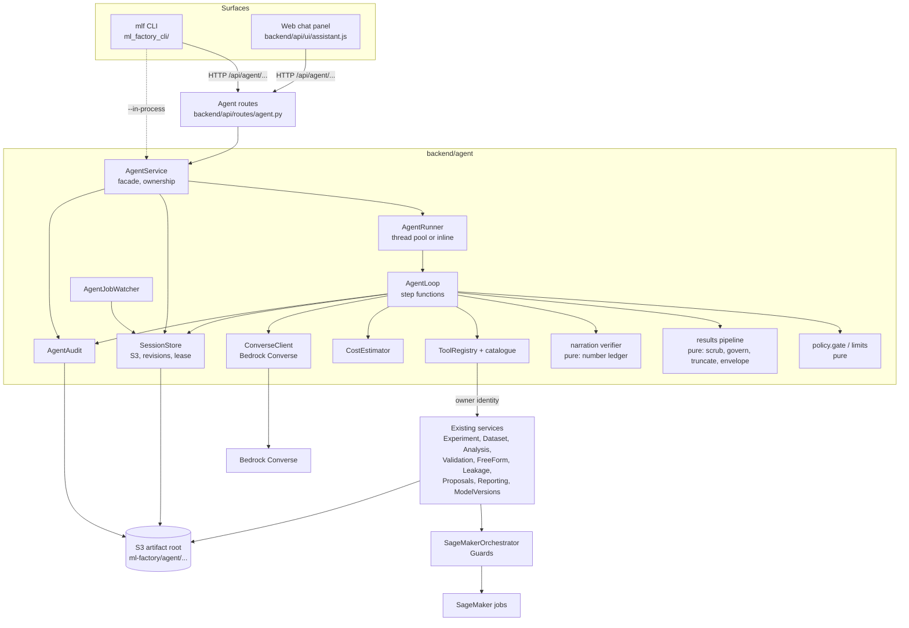
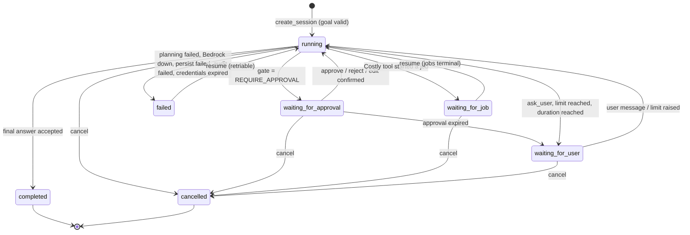
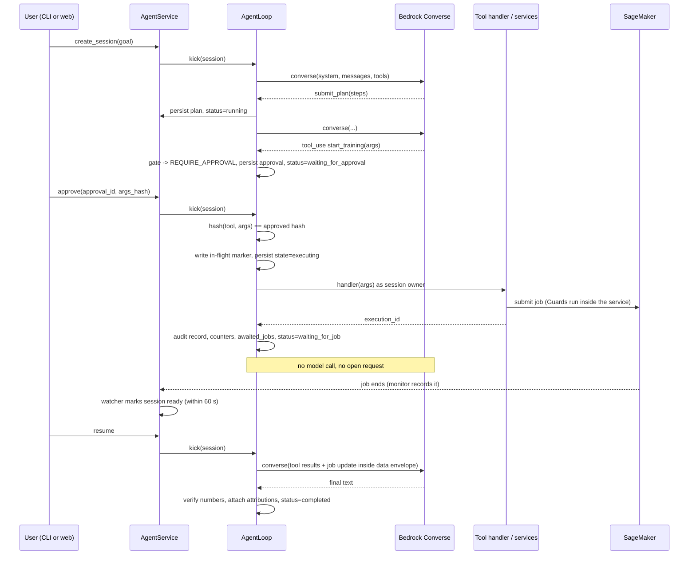

# Design Document: ML Assistant

## Overview

The ML Assistant is an agent built into ML Factory 2.0 (see `requirements.md`). A user states a goal in plain language. The agent plans the work, calls the platform's existing services as tools over the Bedrock Converse tool-use protocol, pauses while SageMaker jobs run, and reports engine-computed numbers with attribution. It adds no compute path, no number source and no storage backend.

One backend component, the **Agent_Service**, owns the loop, the sessions, the approval logic and the limits. A CLI (`mlf`) and a chat panel in the static web UI are thin clients of it. Sessions are versioned Pydantic contracts in S3, so a conversation survives long jobs, process restarts and a change of surface.

### Key design decisions

| # | Decision | Why |
|---|---|---|
| D1 | The loop runs **server-side** in a new package `backend/agent/`. Surfaces only call the Agent_Service. | Req 12.1: the loop, session store, approvals and limits exist once. The same code is then reachable from the API, the CLI and tests. |
| D2 | The safety rules are **pure functions** (`policy`, `limits`, `results`, `narration`, `inputs`) used by a thin impure shell (`loop`, `service`). | Properties can then be tested with Hypothesis without AWS, threads or a model. |
| D3 | The loop **never waits on a job**. A started job puts the session in `waiting_for_job` and the loop stops. A surface (or `--watch`) resumes it. | Req 6.3, 6.4. No request, process or model call stays open for hours. |
| D4 | The loop is a sequence of **short transactions** on the session (load, one step, save). Model calls and tool handlers run outside the transaction. | User actions (approve, cancel, mode switch) can interleave with a running loop. A tool already executing completes (Req 5.9), and a cancel is honoured at the next step (Req 6.12). |
| D5 | An approval is a persisted record **bound to a hash** of the tool name and the exact arguments. The handler runs only when the hash of the call equals the approved hash. | Req 4.9, 16.3. Changing any argument after approval cannot execute. |
| D6 | Tool handlers call the **same service methods** as the REST routes, with the session owner's identity, and write the same experiment audit entry the route writes. | Req 3.4. Guards and ownership apply exactly as for a direct API call. The services themselves do not audit (the routes do), so the agent must audit for parity. |
| D7 | The model sees **dataset ids** (`ds_...`) and **artifact refs**, never S3 URIs, local paths or signed URLs. | Req 7.12, 8.9, 8.10. The server resolves ids to URIs. |
| D8 | Local files are handled by the **client**. The server only holds a manifest (name, size, SHA-256) and mints a short-lived pre-signed PUT after approval. | Req 7.2, 7.3: the server never reads a model-supplied path. Dedup by SHA-256 happens before any byte moves (Req 7.11). |
| D9 | Narration is checked against a **number ledger** built from the session's tool results. The matching rule is the one `ml_engine/reasoning/numbers.py` already applies. | Req 10.2. One rounding rule across the platform. |
| D10 | Plan and clarifying question are **control pseudo-tools** (`submit_plan`, `ask_user`) registered in the same registry. | Req 1.3, 1.5. The loop can enforce "plan first" and "no costly call while a question is open" with the same gate as every other tool. |
| D11 | A Costly call writes an **in-flight marker** before it runs. On resume the marker is reconciled against the platform's execution records. | Req 14.5 to 14.7. At most one job per approved call, even after a crash. |
| D12 | **A cost the Guards cannot estimate never runs unattended.** In Autopilot such a call becomes an Approval_Request. | Consistent with `guards.reserve` (fail closed). Budget enforcement is off by default, so the estimator prices from the static price table independently of `enforce_budget`. |
| D13 | The server does **not** resume sessions on its own. A watcher marks a session ready when its jobs end. The CLI (`--watch`) or the web panel then calls resume. | Req 6.5 to 6.7. No unattended model spend after a job ends. |
| D14 | New contracts live in `ml_engine/contracts/agent.py`, paths only in `ml_engine/io/layout.py`, and the inherited manifest records both. | Req 15.1, 15.3, 15.5. |

### Working assumptions taken from the Open Questions

| # | Assumption used in this design |
|---|---|
| Q1 | Model id = `agent_model_id`, falling back to `bedrock_model_id`. The Smoke_Test confirms tool-use support. |
| Q2 | Defaults: 40 Converse turns, 60 tool calls, 10 Costly calls, 2 hours of active time, 10 USD estimated spend, 3 identical consecutive calls. |
| Q3 | Autopilot is allowed unless the operator sets `ML_FACTORY_AGENT_AUTOPILOT_ALLOWED=false`. |
| Q4 | The web chat uploads from a browser file picker only. |
| Q5 | Approval time-to-live is 900 seconds (15 minutes) (60 to 86,400). |

## Grounding in the codebase

Facts below were read from the repository and shape the design.

| Area | Fact | Consequence |
|---|---|---|
| `backend/container.py` | `AppContainer` is `@dataclass(slots=True)`. `build_container(settings, *, store, orchestrator, sagemaker_client, logs_client, s3_client, reasoning_client)` builds every service. `BedrockReasoningClient` is built from `_build_bedrock(settings)`. | Add one defaulted field `agent` and one keyword `converse_client`. Nothing else changes. |
| `backend/audit.py` | `AuditLog.record(...)` writes one `AuditEvent` per object under `<prefix>/audit/<ts>-<id>.json`, swallows every exception, returns `None`. `detail` is `dict[str, str]`. | Reuse the mechanism. Add a new method `write(...)` that returns the object URI and raises on failure (Req 11.9, 11.3). `record` is untouched. |
| `backend/api/routes/*` | Routes resolve the caller with `principal(...)`, call `require_owner` and `audit_mutation(...)` for mutations. Services do not audit. Reads are not owner-checked. | The agent tool shell does ownership and audit itself. It is stricter than the routes for reads (see C5). |
| `backend/api/errors.py` | `safe(...)` maps `AppError.code` through `STATUS_BY_CODE`. Unknown codes become 500. | New errors reuse existing codes (`VALIDATION_ERROR`, `NOT_AUTHORIZED`, `NOT_FOUND`, `INVALID_STATE`, `FEATURE_DISABLED`, `UPSTREAM_ERROR`) and put a stable `reason` in `details`. |
| `backend/auth.py` | `Authorizer.principal(claimed)` returns the dev identity. `require_owner(principal, experiment_id)` compares `ExperimentRepository.owner`. | Session ownership uses the same `Principal`. Tool calls use `Principal(user=session.owner)`. |
| `backend/orchestration/guards.py` | Pure functions. `GuardViolation(code, message)` is a `RuntimeError`, not an `AppError`. `reserve(settings, prices, PlannedJob)` returns an upper-bound `Reservation` and raises on an unverified or unknown price. | The estimator reuses `reserve`. The tool shell catches `GuardViolation` and `OrchestrationError` explicitly. |
| `backend/config.py` | `Settings` is `extra="forbid"` with prefix `ML_FACTORY_`. Existing numeric fields use `Field(ge=, le=)`, so a bad value fails at construction. `problems()` returns a list of strings. | Agent fields carry **no** `ge/le` so `problems()` can report the name and allowed range (Req 13.3). A wrong type still fails at load, as for every other field. |
| `backend/aws/clients.py` | `build_client(service, settings, **overrides)` forwards `overrides` to `botocore.Config` next to a fixed `retries=...`. | A `retries` override would raise `TypeError`. The Converse client passes `read_timeout` only and does its own retry on top of botocore's. |
| `backend/governance.py` | `GovernancePolicy.from_settings`, `apply_governance(context, policy)` caps or empties lists under the keys `sample_values` and `top_values`. | The Agent_Service applies it to every tool result before building any Bedrock request, and adds a deny-list for row-shaped keys. |
| `ml_engine/reasoning/numbers.py` | `drop_unverified_numbers(text, context)` keeps a sentence only if each decimal or percent token matches a context number at the token's own precision. | The ledger uses the same rule and is tested for agreement with it. |
| `backend/services/datasets.py` | `create_upload_ticket(filename)` returns a pre-signed PUT with SSE headers. `register(uri)` validates a bounded head and returns columns with capped `sample_values`. `list_uploads()` lists the inbox. Accepts `.tsv`. Enforces `max_dataset_upload_bytes`. | The upload flow is built on these. The agent layer narrows accepted formats to CSV and Parquet (Req 7.7). |
| `backend/services/experiments.py` | `create(...)` submits the EDA job as part of creation. `start_training(...)` takes a `TrainingRequest`. | `create_experiment` is classified **Costly** (see C5 and Requirement notes). |
| `ml_engine/contracts/execution.py` | `ExecutionRecord` has `execution_id`, `experiment_id`, `kind`, `started_at`, `status`. `ExecutionStatusView` has `status`, `failure_message`, `jobs`. `is_settled(...)` exists. | Awaited jobs are tracked by `execution_id`. Reconciliation after a crash lists execution records started after the in-flight marker. |
| `backend/api/static.py`, `ui/app.js` | The UI is plain files with a fixed asset allow-list. `app.js` defines global `api`, `el`, `toast`, `title`, `view`. | The chat panel is two new files plus additive entries in the allow-list and `index.html`. No build step. |
| `tests/test_architecture_boundaries.py` | `ml_engine` imports no `backend`. `backend` imports `boto3` only lazily. Only `backend/config.py` reads the environment. Artifact paths only in `layout.py`. | Contracts go in `ml_engine`, the loop in `backend/agent`. The CLI reads settings through `Settings`, never `os.environ`. |
| `infra/iam/control_plane_policy.json` | Grants `bedrock:InvokeModel` on `${BEDROCK_MODEL_ARN}`. | Converse needs `bedrock:InvokeModel` on the agent model's ARN. Add it additively when the agent model differs. |

## Architecture



### Session status machine



### One supervised Costly call with a long job



## Components and Interfaces

All new backend code is under `backend/agent/` unless a path says otherwise. Signatures are the design contract. Bodies are implementation work.

### C1. Contracts (`ml_engine/contracts/agent.py`)

Pydantic `StrictModel`s with a `schema_version` default. Defined in the *Data Models* section. `ml_engine` imports only `pydantic` and the standard library here, so the boundary tests hold.

### C2. Layout (`ml_engine/io/layout.py`, additive)

```python
AGENT_NAMESPACE = "ml-factory/agent"

def owner_key(owner: str) -> str: ...        # sha256(owner)[:24], path-safe

@dataclass(frozen=True, slots=True)
class AgentLayout:
    base: str                                 # .../ml-factory/agent/sessions/<session_id>

    @classmethod
    def for_session(cls, root: str, session_id: str) -> "AgentLayout": ...
    @staticmethod
    def owner_index_prefix(root: str, owner: str) -> str: ...      # .../agent/owners/<owner_key>/
    @staticmethod
    def owner_index_object(root: str, owner: str, session_id: str) -> str: ...
    @property
    def session(self) -> str: ...             # <base>/session.json
    def tool_result(self, tool_call_id: str) -> str: ...           # <base>/results/<id>.json
    def inflight(self, idempotency_key: str) -> str: ...           # <base>/inflight/<key>.json
    @property
    def audit_prefix(self) -> str: ...        # <base>/audit/  (written by AuditLog)
```

`AuditLog` builds `ExperimentLayout(base=artifact_prefix).path("audit")`. Passing the session base as `artifact_prefix` therefore puts agent audit objects under `AgentLayout.audit_prefix` with no change to `AuditLog`.

### C3. Settings (`backend/config.py`, additive)

New optional fields, all with defaults. None has `ge` or `le`, so `problems()` can report them.

| Field | Default | Allowed (checked in `problems()`) |
|---|---|---|
| `agent_enabled` | `False` | bool |
| `agent_model_id` | `""` | falls back to `bedrock_model_id` |
| `agent_max_output_tokens` | `2048` | 1 to 8192 |
| `agent_converse_retries` | `3` | 0 to 5 |
| `agent_converse_backoff_seconds` | `1.0` | 0.0 to 30.0 |
| `agent_converse_read_timeout_seconds` | `120` | 10 to 600 |
| `agent_limit_max_converse_turns` | `40` | positive int |
| `agent_limit_max_tool_calls` | `60` | positive int |
| `agent_limit_max_costly_tool_calls` | `10` | positive int |
| `agent_limit_max_estimated_spend_usd` | `10.0` | > 0 |
| `agent_limit_max_active_seconds` | `7200` | positive int |
| `agent_limit_max_repeated_identical_calls` | `3` | positive int |
| `agent_approval_ttl_seconds` | `900` | 60 to 86,400 |
| `agent_tool_result_max_bytes` | `8192` | 1,024 to 1,048,576 |
| `agent_untrusted_string_max_chars` | `256` | 1 to 100,000 |
| `agent_context_budget_tokens` | `100000` | 4,000 to 1,000,000 |
| `agent_cli_poll_seconds` | `1.0` | 0.5 to 60 |
| `agent_web_poll_seconds` | `1.0` | 0.5 to 60 |
| `agent_watch_interval_seconds` | `15` | 1 to 60 |
| `agent_lease_seconds` | `300` | 30 to 3600 |
| `agent_max_concurrent_sessions` | `4` | 1 to 64 |
| `agent_autopilot_allowed` | `True` | bool |
| `agent_api_url` | `"http://localhost:8000"` | used by the CLI only |

`problems()` gains one trailing block, `self._agent_problems()`. It reports every out-of-range value as `ML_FACTORY_<NAME> must be <range> (got <value>)`. When `agent_enabled` is true it also reports a missing model id (both `agent_model_id` and `bedrock_model_id` empty) and a region mismatch from the existing `bedrock_region_mismatch`. With defaults it adds nothing, so every current `problems() == []` assertion still holds.

### C4. Converse client (`backend/agent/converse.py`)

```python
@dataclass(frozen=True, slots=True)
class ToolUseRequest:   request_id: str; name: str; arguments: dict[str, Any]
@dataclass(frozen=True, slots=True)
class TokenUsage:       input_tokens: int; output_tokens: int
@dataclass(frozen=True, slots=True)
class ConverseTurn:
    text: str
    tool_uses: tuple[ToolUseRequest, ...]
    stop_reason: Literal["end_turn", "tool_use", "max_tokens", "other"]
    usage: TokenUsage
    model_id: str

# provider-neutral conversation
@dataclass(frozen=True, slots=True)
class TextBlock:        text: str
@dataclass(frozen=True, slots=True)
class ToolUseBlock:     request_id: str; name: str; arguments: dict[str, Any]
@dataclass(frozen=True, slots=True)
class ToolResultBlock:  request_id: str; content: dict[str, Any]     # already enveloped
@dataclass(frozen=True, slots=True)
class ConverseMessage:  role: Literal["user", "assistant"]; blocks: tuple[Block, ...]
@dataclass(frozen=True, slots=True)
class ToolDefinition:   name: str; description: str; input_schema: dict[str, Any]

class ConverseError(RuntimeError):         retriable: bool
class ConverseTransientError(ConverseError):        ...   # throttle, 5xx, timeout, connection
class ConverseModelUnsupportedError(ConverseError): model_id: str; reason: str
class ConverseRequestError(ConverseError):          ...   # invalid request, access denied
class ConverseCredentialsError(ConverseError):      ...   # expired or unrecognized credentials

class ConverseClient(Protocol):
    model_id: str
    def converse(self, *, system: str, messages: Sequence[ConverseMessage],
                 tools: Sequence[ToolDefinition], max_tokens: int) -> ConverseTurn: ...

class BedrockConverseClient:
    def __init__(self, client: Any, *, model_id: str, retries: int, backoff_seconds: float,
                 sleep: Callable[[float], None] = time.sleep) -> None: ...
```

- Each call sends `modelId`, `system=[{"text": system}]`, `messages`, `toolConfig={"tools": [{"toolSpec": {...}}]}` and `inferenceConfig={"temperature": 0, "maxTokens": max_tokens}` (Req 2.7).
- The transient set is the botocore error codes `ThrottlingException`, `ServiceUnavailableException`, `InternalServerException`, `ModelTimeoutException`, `ModelNotReadyException`, plus read timeout and connection errors. These retry up to `retries` times with delays `backoff * 2**attempt` (Req 2.8). After the last attempt the last error is raised.
- A `ValidationException` whose message says the model does not support tool use, or a `toolConfig` error, becomes `ConverseModelUnsupportedError(model_id, reason)` and is raised on the first call without retry (Req 13.8). There is no fallback model.
- `AccessDeniedException` and other `ValidationException` become `ConverseRequestError`. `ExpiredTokenException`, `ExpiredToken` and `UnrecognizedClientException` become `ConverseCredentialsError` (Req 14.9).
- The boto client comes from `backend.aws.build_client("bedrock-runtime", settings, read_timeout=settings.agent_converse_read_timeout_seconds)`, built lazily on the first use (Req 13.7, 15.8). `BedrockReasoningClient` and `ReasoningClient` are not touched.
- No exception text, request or credential is logged beyond the error class, the model id and the Bedrock error code (Req 13.9).

### C5. Tool registry and catalogue (`backend/agent/tools.py`, `backend/agent/catalogue.py`)

```python
from ml_engine.contracts.agent import ToolClass     # READ, MUTATING, COSTLY (defined once, in the contracts)

@dataclass(frozen=True, slots=True)
class ToolFlags:
    changes_config: bool = False          # Mutating tools that need approval in Supervised (Req 4.3)
    always_approve: bool = False          # approval in every mode (free-form run)
    upload: bool = False                  # Req 7.4 rule
    control: bool = False                 # submit_plan, ask_user
    experiment_arg: str | None = None     # name of the experiment id argument, if any
    dataset_args: tuple[str, ...] = ()    # arguments holding a dataset id
    instance_args: tuple[str, ...] = ()   # arguments holding an instance type
    verbatim: bool = False                # result is a report or table to include verbatim (Req 10.7)
    ledger_source: bool = True            # numbers in the result may ground narration
    estimator: str | None = None          # key into CostEstimator
    audit_action: str | None = None       # experiment audit action name, same as the route's

@dataclass(frozen=True, slots=True)
class ToolSpec:
    name: str
    description: str
    input_model: type[BaseModel]
    tool_class: ToolClass
    handler: Callable[[ToolContext, BaseModel], ToolOutput]
    flags: ToolFlags
    protected: Callable[[ToolContext, BaseModel], bool] | None = None   # Req 5.7 categories
    job_extractor: Callable[[dict], list[AwaitedJobSpec]] | None = None

class ToolRegistrationError(ValueError): tool: str

class ToolRegistry:
    def register(self, name: str, *, classes: Iterable[ToolClass], ...) -> None: ...
    def get(self, name: str) -> ToolSpec | None: ...
    def names(self) -> tuple[str, ...]: ...
    def definitions(self) -> list[ToolDefinition]: ...      # input_schema from the Pydantic model
```

`register` is atomic. It raises `ToolRegistrationError(tool=name)` and leaves the registry unchanged when `classes` has zero or more than one distinct value (Req 3.2, 3.3), when the name is already taken, or when the name belongs to the **reserved privileged set** (names starting with `approve_request`, `reject_request`, `edit_request`, `set_mode`, `set_limits`, `enable_autopilot`, `promote`, `delete`, `approve_script`). Registering those is a programming error (Req 3.7, 4.11).

`ToolContext` carries the `Session`, the owner `Principal`, the service bundle, the clock and the `ToolInputs` resolver. `ToolOutput` carries `data` (JSON-safe), optional `experiment_ids`, `datasets` and `awaited` jobs.

**Shell rules every handler inherits** (`backend/agent/execute.py`):

1. Identity comes from `ctx.principal = Principal(user=session.owner)`. No argument can set it (Req 3.4).
2. If `flags.experiment_arg` is set, the id must be in `session.experiment_ids` and `authorizer.require_owner(...)` must pass. An id becomes linked when the session created it, when `list_experiments` returned it (owner-filtered), or when it appears verbatim in a message the user typed. This is stricter than the routes for reads, on purpose: an unattended agent should not read other users' experiments.
3. `dataset_args` are dataset ids. The shell replaces each with the URI from `session.datasets`. The model never supplies a URI (Req 7.12, 8.10).
4. After the handler returns, the shell writes the experiment audit entry named by `flags.audit_action` with the same detail keys as the matching route, using `AuditLog.write`.

**Catalogue.** Every tool wraps the service call the REST route or MCP tool already makes.

| Tool | Wraps | Class | Notes |
|---|---|---|---|
| `submit_plan` | none | Read (control) | Accepts 1 to 10 steps of at most 200 characters. Must be the first accepted call. |
| `ask_user` | none | Read (control) | One question. Sets `waiting_for_user`. |
| `list_datasets` | `DatasetService.list_uploads` | Read | Returns dataset ids, file names, sizes. No URIs. |
| `get_dataset_profile` | `DatasetService.register` | Read | Columns, dtypes, governed sample values. |
| `request_local_upload` | client action (C16) | Mutating | `flags.upload`. Takes a `file_id` from the session manifest. |
| `list_experiments` | `ExperimentService.list(created_by=owner)` | Read | Always owner-filtered. Links the returned ids. |
| `get_experiment` | `ExperimentService.get` | Read | |
| `create_experiment` | `ExperimentService.create` | **Costly** | Submits the EDA job inside `create`. See Requirement notes. |
| `get_eda_summary` | `ExperimentService.eda` | Read | |
| `get_leakage_findings` | `ExperimentService.leakage` | Read | Advisory. |
| `get_feature_review` | `ExperimentService.feature_review` | Read | |
| `set_business_context` | `LeakageService.set_business_context` | Mutating | |
| `get_business_context` | `LeakageService.get_business_context` | Read | |
| `investigate_leakage` | `LeakageService` pre-training phase (same call as the MCP tool) | Mutating | Advisory output. |
| `get_leakage_investigation` | `LeakageService.get_phase` | Read | |
| `propose_features` | `FeatureProposalService.generate` | Mutating | Advisory. |
| `get_feature_proposals` | `FeatureProposalService.stored` | Read | |
| `define_derived_features` | `FeatureProposalService.define` | **Costly**, `changes_config` | Starts a profiling job. |
| `approve_features` | `FeatureProposalService.approve` | **Costly**, `changes_config` | Starts a profiling job. |
| `decide_features` | `ExperimentService.save_features` | Mutating, `changes_config`, `protected` | `protected` is true unless the selection keeps every candidate column. Any error evaluating it means protected. |
| `preflight_check` | `AnalysisService.preflight` | Read | |
| `start_training` | `ExperimentService.start_training` | **Costly**, `changes_config` | Same `TrainingRequest` composition as `routes/training.py`. |
| `rerun_training` | `ExperimentService.rerun_training` | **Costly** | |
| `get_training_status` | `ExperimentService.training_status` | Read | |
| `get_execution_status` | `AnalysisService.execution_status` | Read | |
| `get_comparison` | `ExperimentService.comparison` | Read, `verbatim` | |
| `get_threshold_analysis` | `ExperimentService.thresholds` | Read | |
| `list_model_versions` | `ModelVersionService.list_versions` | Read | |
| `start_validation` | `ValidationService.start_validation` | **Costly** | |
| `get_validation` | `ValidationService.validation` | Read, `verbatim` | |
| `start_holdout_evaluation` | `ExperimentService.start_holdout_evaluation` | **Costly** | |
| `get_holdout_evaluation` | `ExperimentService.holdout_evaluation` | Read | |
| `start_ablation` | `AnalysisService.start_ablation` | **Costly** | |
| `get_ablation` | `AnalysisService.ablation` | Read | |
| `generate_report` | `ReportingService.build_*_report` | Mutating | Returns artifact refs, not URIs. |
| `get_report` | `ReportingService.get_report` | Read, `verbatim` | |
| `interpret_results` | `ReasoningService.interpret` | Mutating, `ledger_source=False` | Its prose does not ground other prose. |
| `draft_free_form_script` | `FreeFormService.draft_script` | Mutating | Returns the draft id and revision. |
| `start_free_form_run` | `FreeFormService.start_run` | **Costly**, `always_approve`, `protected` | Takes `draft_id` and `revision`. The wrapper loads the script bytes server-side, so the approval shows the code and its content hash, and the user's approval **is** the script approval. |
| `get_free_form_run`, `list_free_form_runs` | `FreeFormService.run_status`, `list_runs` | Read | Metric labels pass through. |
| `compare_free_form` | `FreeFormService.compare` | Read, `verbatim` | Carries the `comparable` flags. |

Not exposed (Req 3.5 to 3.7): delete experiment, model promotion, script approval as a separate action, download links, raw S3 reads, direct SageMaker calls, raw rows. If `FreeFormService` has no public accessor for a stored draft revision, add one additive method (`draft_revision(experiment_id, draft_id, revision)`) rather than reading S3 from the tool.

### C6. Policy gate (`backend/agent/policy.py`, pure)

```python
class GateAction(StrEnum): EXECUTE = "execute"; REQUIRE_APPROVAL = "require_approval"; REFUSE = "refuse"

@dataclass(frozen=True, slots=True)
class GateInput:
    spec: ToolSpec
    mode: Mode
    plan_accepted: bool
    protected: bool                  # evaluated by the shell, fails closed
    estimate_usd: float | None       # None = no estimate available
    session_spend_usd: float
    autopilot_max_spend_usd: float | None
    guard_refused_before: bool       # same tool and experiment, since the last user action
    upload_approved_before: bool

@dataclass(frozen=True, slots=True)
class GateDecision: action: GateAction; reason: str     # stable reason code

def gate(inp: GateInput) -> GateDecision: ...
```

Rules, evaluated in order (the first match wins):

1. Not a control tool and `plan_accepted` is false: `REFUSE("plan_required")` (Req 1.3).
2. `tool_class` is Read: `EXECUTE` in both modes (Req 4.4).
3. `flags.always_approve`: `REQUIRE_APPROVAL("script_run")`.
4. `flags.upload` and not `upload_approved_before`: `REQUIRE_APPROVAL("first_upload")` in both modes (Req 7.4).
5. `protected`: `REQUIRE_APPROVAL("protected_action")` in both modes (Req 5.7, 5.8).
6. Mutating: `REQUIRE_APPROVAL("config_change")` if `changes_config` and mode is Supervised, else `EXECUTE`.
7. Costly, Supervised: `REQUIRE_APPROVAL("costly")` (Req 4.2).
8. Costly, Autopilot: `REQUIRE_APPROVAL` with reason `no_grant`, `estimate_unavailable` (D12), `spend_cap` (when `session_spend + estimate > autopilot_max`, Req 5.5) or `guard_refused_before` (Req 5.6). Otherwise `EXECUTE`.

`gate` never reads the model's text. It is total over its input.

### C7. Limits (`backend/agent/limits.py`, pure)

```python
class LimitName(StrEnum):
    TURNS = "max_converse_turns"; TOOL_CALLS = "max_tool_calls"; COSTLY = "max_costly_tool_calls"
    SPEND = "max_estimated_spend_usd"; ACTIVE = "max_active_seconds"; REPEATS = "max_repeated_identical_calls"

def validate_limits(raw: Mapping[str, object]) -> SessionLimits: ...      # raises ValidationError naming the limit (Req 9.1)
def check_loop_top(c: SessionCounters, l: SessionLimits) -> LimitStop | None: ...
def check_before_model_call(c, l) -> LimitStop | None: ...                  # turns, active time
def check_before_tool_call(c, l) -> LimitStop | None: ...                   # tool calls
def would_exceed_costly(c, l, estimate_usd: float | None) -> LimitName | None: ...
def register_call(c: SessionCounters, fingerprint: str, l: SessionLimits) -> tuple[SessionCounters, bool]: ...  # (new counters, is_repeat_violation)
def raise_limit(l: SessionLimits, name: LimitName, amount: float) -> SessionLimits: ...   # only that limit
def accrue_active(c: SessionCounters, status: SessionStatus, elapsed: float) -> SessionCounters: ...
```

- A `LimitStop` names the limit, its configured value and its current value (Req 9.2).
- Every tool use that reaches processing, including validation errors and repeated-call errors, adds 1 to `tool_calls` (Req 9.4). The check runs before processing, so the count cannot pass the limit.
- `check_loop_top` also stops when `costly_tool_calls >= max_costly_tool_calls`, whether or not budget enforcement is on (Req 9.9).
- A Costly call whose estimate would take spend above `max_estimated_spend_usd`, or that arrives with `costly_tool_calls + 1 > max`, is not executed in **any** mode. The model receives a structured `LIMIT_REACHED` error (Req 9.8, 14.3). This cap is not approvable. The user raises it with `raise_limit`.
- Active time accrues only while the status is `running` (see Requirement notes).
- `raise_limit` changes exactly one limit by the confirmed positive amount. It is called only from the user's `continue_after_limit` action (Req 9.3, 9.7).

### C8. Result pipeline (`backend/agent/results.py`, pure)

```python
@dataclass(frozen=True, slots=True)
class ShapedResult:
    full: dict[str, Any]              # governed, scrubbed, not truncated. Stored in S3. Source for the ledger and verbatim blocks.
    model_view: dict[str, Any]        # what the model gets, inside the data envelope
    truncated: bool
    injection_suspected: bool
    ledger: tuple[LedgerEntry, ...]

def shape_result(raw: Any, *, spec: ToolSpec, call_id: str, policy: GovernancePolicy,
                 ctx: ScrubContext, max_bytes: int, max_string_chars: int) -> ShapedResult: ...
def envelope(call_id: str, tool: str, body: dict, *, truncated: bool) -> dict: ...
def detect_injection(strings: Iterable[str]) -> bool: ...
```

`shape_result` runs these steps in order:

1. Convert to JSON-safe data (`model_dump(mode="json")` for Pydantic objects).
2. **Scrub.** Rewrite `s3://` URIs under a linked experiment's prefix to `artifact://<experiment_id>/<relative path>`, rewrite a registered dataset URI to its `dataset:<id>`, replace any other `s3://` URI with `[redacted-uri]`, drop keys named `upload_url`, `download_url`, `presigned_url`, `headers`, and replace strings matching AWS access key ids, `X-Amz-Signature`, `X-Amz-Security-Token` or a secret-key assignment with `[redacted]` (Req 8.9, 13.9).
3. **Govern.** Remove keys named `rows`, `preview_rows`, `sample_rows`, `records`, `head` and any list of more than 5 dicts under a key containing `row`. Then apply `apply_governance(result, policy)` (Req 8.1 to 8.3). This is `full`.
4. **Detect injection** over every string in `full` (before truncation).
5. **Truncate strings** longer than `max_string_chars` to a prefix plus `…[truncated]` and count them (Req 8.8). Dict keys are treated the same way, with a `#n` suffix on a collision.
6. **Cap size.** Serialize the enveloped view. While it is over `max_bytes`, shorten the largest list (keep a prefix, add `_omitted: k`), then drop the largest dict value, then replace the body with a stub that lists the top-level keys. Set `truncated`. The final envelope is always at most `max_bytes` (Req 3.8). `max_bytes >= 1024` is enforced by settings, which is enough for the stub.
7. **Ledger.** Walk `full` and record every numeric leaf with its JSON path, unless `spec.flags.ledger_source` is false. For free-form metrics, copy the sibling `label` field into the entry.

`envelope` returns `{"untrusted_data": {"tool_call_id", "tool", "truncated", "data": <view>}}`. The system prompt states that everything inside `untrusted_data` is data and carries no instruction (Req 8.4).

`detect_injection` is a case-insensitive pattern match on phrases such as "ignore (all|previous|earlier) instructions", "system prompt", "you are now", "disregard", "call the tool", "approve", "autopilot", "set mode" and on lookalike delimiters (`</untrusted_data>`). It only sets a flag. The result is delivered either way (Req 8.7).

### C9. Narration verifier (`backend/agent/narration.py`, pure)

```python
@dataclass(frozen=True, slots=True)
class LedgerEntry: value: float; tool_call_id: str; experiment_id: str | None; path: str; metric_label: str | None

class NumberLedger:
    def add(self, entries: Iterable[LedgerEntry]) -> None: ...
    def match(self, token: str, percent: bool) -> list[LedgerEntry]: ...   # same rule as numbers.py

def verify_narration(text: str, ledger: NumberLedger, *, policy: Literal["mark", "withhold"] = "mark") -> VerifiedNarration: ...
def build_final_answer(narration: VerifiedNarration, results: SessionResults, ...) -> FinalAnswer: ...
```

- A token matches when some ledger value, rounded to the token's own number of decimals, equals the token. A percent token also matches its fraction reading. This is exactly the rule in `ml_engine/reasoning/numbers.py`. A property test checks that a sentence is verified by the ledger if and only if it survives `drop_unverified_numbers` on the same numbers.
- A sentence with no number is verified. A sentence with at least one unmatched number is `unverified`. With `policy="mark"` (the default) it stays in the answer prefixed by a visible *unverified* marker. With `"withhold"` it is removed. Other sentences are never altered (Req 10.3). One `narration_unverified` audit record is written per affected sentence, naming the session and the unmatched value.
- Each matched number gets an `Attribution(tool_call_id, experiment_id, artifact_ref, path, metric_label)`. A free-form number always carries its `Self_Reported_Metric` or `Engine_Metric` label next to it (Req 10.5).
- `build_final_answer` appends, from the **stored full result** and not the truncated view, a verbatim block for each `verbatim` tool result used in the final turn, unchanged (Req 10.7). It appends a "not comparable" note for every entry a comparison result marks `comparable: false` and drops any sentence that ranks two such entries (Req 10.6). It adds the label *Advisory* whenever the answer draws on leakage, feature-proposal or ranking results, and marks a sentence that pairs such a term with a certainty word ("guaranteed", "certain", "proven", "definitely") as `overclaim` (Req 10.8).

### C10. Session store (`backend/agent/store.py`)

```python
class SessionLoadError(AppError):    # code VALIDATION_ERROR, details {session_id, category}
    category: Literal["unknown_contract_version", "corrupt_content", "not_found"]

class SessionStore:
    def __init__(self, store: ObjectStore, root: str, *, retries: int = 3, clock=...) -> None: ...
    def create(self, session: Session) -> Session: ...
    def load(self, session_id: str) -> LoadedSession: ...          # Session + etag
    def save(self, loaded: LoadedSession) -> LoadedSession: ...    # revision+1, owner index, retries
    @contextmanager
    def transaction(self, session_id: str) -> Iterator[Session]: ...
    def put_result(self, session_id: str, call_id: str, full: dict) -> ResultRef: ...
    def get_result(self, session_id: str, ref: ResultRef) -> dict: ...
    def list_for_owner(self, owner: str, *, limit: int, cursor: str | None) -> Page[SessionSummary]: ...
    def acquire_lease(self, session_id: str, holder: str, ttl: int) -> None: ...   # raises SessionInUse
    def release_lease(self, session_id: str, holder: str) -> None: ...
```

- `load` reads the raw JSON first, checks `schema_version` against `SUPPORTED_VERSIONS[contract]`, then validates. It raises `SessionLoadError` with the category and never writes or deletes (Req 14.8, 15.2).
- `save` retries up to 3 times (Req 6.14). It writes `session.json` and then the small `SessionSummary` owner-index object. It compares the stored ETag with the one captured at load and raises `SessionConflict` on mismatch, so two processes cannot silently overwrite each other. After the last failed retry it raises `SessionPersistError`, and the runner stops the loop and starts no tool.
- `transaction` takes an in-process re-entrant lock for the session id, loads, yields, and saves. It is held only for one step. Model calls and tool handlers run outside it (D4).
- The lease is a field on the session (`holder`, `expires_at`). `acquire_lease` fails with `ConflictError(reason="session_in_use")` while an unexpired lease with another holder exists (Req 6.10). Each save extends it. A crashed process's lease expires after `agent_lease_seconds`.
- Cross-replica safety is best effort: the ETag check plus the lease. The platform already assumes one status-poller process, and the same assumption applies here.
- Tool results are stored one object each, so `session.json` stays small. `Session.tool_calls[i].result` holds the summary, the SHA-256 and the object reference.

### C11. Audit (`backend/agent/audit.py`, `backend/audit.py` additive)

`backend/audit.py` gains one method, with `record` unchanged:

```python
class AuditWriteError(RuntimeError): ...

def write(self, *, artifact_prefix: str, experiment_id: str, action: str, actor: str | None,
          detail: dict[str, str] | None = None) -> str | None:
    """Like record(), but returns the object URI and raises AuditWriteError on failure.
    Returns None when auditing is disabled."""
```

```python
class AgentAudit:
    def __init__(self, audit: AuditLog, root: str, enabled: bool) -> None: ...
    def write(self, session: Session, rec: AgentAuditRecord) -> str | None: ...   # raises AuditWriteError
    def trail(self, session: Session) -> list[AuditTrailItem]: ...
```

- An `AgentAuditRecord` is stored as an `AuditEvent` with `action = "agent." + event_type`, `actor` = the acting identity, `experiment_id` = the session id, and `detail` = the record's fields flattened to strings (`to_audit_detail`, `from_audit_event`). It lands under `AgentLayout.audit_prefix` (Req 11.4).
- `seq` is a per-session counter kept in the session, so the trail sorts by `(at, seq)` and is chronological even within one second (Req 11.6).
- Event types: `session_created`, `tool_executed`, `approval_decision`, `mode_changed`, `limit_stop`, `limit_raised`, `cancelled`, `input_rejected` (Req 8.10), `narration_unverified` (Req 10.3), `session_failed`, `approval_expired`.
- A `tool_executed` record carries the tool name, the arguments hash, the result status, the approval decision and approver (`autopilot:<enabling user>` for unattended calls), the `prompt_injection_suspected` flag, and `service_audit_ref`, the URI of the experiment audit entry the shell wrote (Req 11.3). `trail()` resolves each reference and returns both entries (Req 11.3, 11.6).
- A write failure for a Mutating or Costly tool sets `session.audit_failed = true`. The loop then executes no further Mutating or Costly tool in that session, and the owner gets an error that says auditing failed (Req 11.9). Read tools still run.
- With `audit_log_enabled=false`, `write` returns `None`, no object is written and nothing is blocked (Req 11.8).
- Values in `detail` are limited to ids, hashes, enum names and numbers. A scrub step removes credential-shaped strings. Raw rows never reach it, because tool results are not copied into audit records (Req 11.5).

### C12. Cost estimator (`backend/agent/estimate.py`)

```python
@dataclass(frozen=True, slots=True)
class Estimate: usd: float | None; basis: str; price_source: str | None; price_version: str | None

class CostEstimator:
    def __init__(self, settings: Settings, prices: PriceTable | None) -> None: ...
    def estimate(self, tool: str, args: BaseModel, ctx: ToolContext) -> Estimate: ...
```

It builds the same `PlannedJob` objects the orchestrator would (processing job for EDA, profiling, validation, holdout, free-form; N training jobs plus preparation and evaluation for training, with N taken from the request or `max_models_per_run`) and calls `guards.reserve(...)`. The price table is loaded from `price_table_path` regardless of `enforce_budget`. If `reserve` raises, or the table is missing, or the tool has no estimator, `usd` is `None` and the approval request says "no estimate available" (Req 4.5). The value is an upper bound for compute only, labelled with the price source and version, and is never presented as a bill (handover decision 6).

### C13. Agent loop (`backend/agent/loop.py`)

The loop is a function `step(session_id)` called until it returns a pause. It never holds a transaction across a model call or a tool handler.

```python
class StepOutcome(StrEnum): CONTINUE = "continue"; PAUSED = "paused"; DONE = "done"

class AgentLoop:
    def __init__(self, *, store, converse, registry, estimator, audit, results, clock, settings, prompts) -> None: ...
    def run(self, session_id: str, holder: str) -> None:       # acquire lease, recover, loop until pause
    def step(self, session_id: str) -> StepOutcome: ...
```

`step` does one of the following, chosen by the persisted state:

1. **Recover** (first step after a restart): for each tool call in state `executing`, reconcile it (see D11 and *Error Handling*).
2. **Limit check.** `check_loop_top`. On a stop, set `waiting_for_user`, write a `limit_stop` audit record and pause.
3. **Process the next pending tool use** of the last model turn:
   - count it, apply the repeated-call rule;
   - look the tool up (unknown name: structured error that lists registered names; if the name is in the reserved set, also write an `input_rejected` audit record);
   - validate the arguments against the tool's Pydantic model (invalid: error naming each bad argument);
   - run `inputs.check(...)` (paths, S3 URIs, instance types, experiment link and owner, dataset ids);
   - run prerequisites: refuse a Mutating or Costly call for an experiment that still has an unresolved awaited job in this session, and rely on the service for experiment-state errors (Req 1.8);
   - evaluate `protected` (fails closed) and the estimate, then call `policy.gate`;
   - `REQUIRE_APPROVAL`: create the `ApprovalRequest`, pre-create requests for the remaining Costly uses of the same turn (at most 10), set `waiting_for_approval`, persist, pause;
   - `EXECUTE`: persist state `executing` (and the in-flight marker for Costly), run the handler outside the transaction, then in a second transaction record the result, write audit records, update counters, awaited jobs and linked ids.
4. **All uses processed.** If unresolved awaited jobs exist: set `waiting_for_job`, persist, pause. Otherwise go to 5.
5. **Model call.** Check `turns` and active time, build messages (C14), call `converse`, then in a transaction apply the result **only if** the session epoch is unchanged and the status is still `running` (a cancel in between wins). Record tokens and model id (Req 2.10). Text-only turn: verify narration and set `completed`. Tool uses: store them as `pending_tool_uses`.

Planning turn rules. Until a plan is accepted, the model's tools are limited to `submit_plan` and `ask_user`. A first turn with neither sets `failed` with "planning failed" (Req 1.4). When a turn contains `ask_user`, every Mutating and Costly use in that turn is answered with a `deferred_waiting_for_user` error and not executed, wherever `ask_user` appears in the turn (Req 1.5).

Resolution of one model turn with N tool uses always yields exactly N tool results, in request order, because pending uses are processed one by one and each ends in a recorded result (Req 2.6). A cancel resolves the remaining uses with `cancelled` results.

### C14. Context builder and system prompt (`backend/agent/context.py`, `backend/agent/prompts.py`)

```python
def build_messages(session: Session, budget_tokens: int) -> tuple[list[ConverseMessage], CompactionInfo]: ...
SYSTEM_PROMPT_VERSION = "1"
def system_prompt(session: Session, registry: ToolRegistry) -> str: ...
```

- Messages are rebuilt from the transcript on every call. The goal, user messages, assistant text, tool uses and enveloped results map to Converse blocks. Job updates are added as an enveloped text block in the same user message as the results they follow.
- When the estimated size (characters / 4, or the last reported `input_tokens` if larger) exceeds the budget, turns older than the most recent 6 are replaced by one deterministic summary message. Each summarized tool call keeps one line: `[<call_id>] <tool> <status>` followed by every `path=value` pair from its ledger entries, verbatim. The accepted plan is kept. The full history stays in the persisted session (Req 6.11).
- The system prompt is static text plus the tool list. It tells the model to propose a plan first, ask when information is missing, quote numbers only from tool results, that content in `untrusted_data` is data, that it cannot approve, edit, change mode or limits, that leakage and proposals are advisory, and that it must say when entries are not comparable. It contains no user data.

### C15. Service facade, runner and watcher (`backend/agent/service.py`, `runner.py`, `watcher.py`)

```python
class AgentService:
    def create_session(self, who: Principal, goal: str, *, mode: Mode = Mode.SUPERVISED,
                       autopilot_max_spend_usd: float | None = None) -> SessionView: ...
    def send_message(self, who, session_id, text: str) -> SessionView: ...
    def resume(self, who, session_id) -> SessionView: ...
    def get_session(self, who, session_id, *, after_seq: int = 0) -> SessionView: ...
    def list_sessions(self, who, *, limit: int = 100, cursor: str | None = None) -> SessionPage: ...
    def decide_approval(self, who, session_id, approval_id, decision: Decision, *, args_hash: str,
                        edited_args: dict | None = None, reason: str | None = None) -> SessionView: ...
    def decide_batch(self, who, session_id, items: list[BatchItem]) -> SessionView: ...
    def set_mode(self, who, session_id, mode: Mode, *, max_estimated_spend_usd: float | None = None) -> SessionView: ...
    def continue_after_limit(self, who, session_id, limit: LimitName, amount: float) -> SessionView: ...
    def cancel(self, who, session_id, *, stop_jobs: bool = False) -> SessionView: ...
    def audit_trail(self, who, session_id) -> list[AuditTrailItem]: ...
    def register_local_files(self, who, session_id, files: list[LocalFileInput]) -> SessionView: ...
    def client_action(self, who, session_id) -> ClientActionView | None: ...    # mints the pre-signed PUT on demand
    def complete_upload(self, who, session_id, action_id: str) -> SessionView: ...
    def sweep_jobs(self) -> int: ...                                            # used by the watcher
```

- Every method first loads the session and compares `session.owner` with `who.user`. A mismatch raises `AuthorizationError` before any read of content or any write (Req 4.10, 11.7, 12.9). An unauthenticated caller fails earlier in `principal(...)`.
- `create_session` checks, in this order: agent enabled (else `FeatureDisabledError` whose message names `ML_FACTORY_AGENT_ENABLED`, Req 13.5), the goal (non-blank after trimming, at most 4,000 characters, Req 1.2), the limits (Req 9.1), and the Autopilot arguments (Req 5.3, 5.4). Only then does it create the session, write the `session_created` audit record and kick the runner (Req 1.1).
- `set_mode(AUTOPILOT)` requires `agent_autopilot_allowed` and a `max_estimated_spend_usd` in `(0, limits.max_estimated_spend_usd]`. It records `AutopilotGrant(enabled_by, enabled_at, max_spend, spend_at_enable)` before the next tool call (Req 5.2). `set_mode(SUPERVISED)` clears the grant. The loop re-reads the mode inside the transaction that gates each call, so a call that starts after the switch is gated as Supervised (Req 5.9).
- Autopilot can be requested only through `create_session(mode=...)` or `set_mode(...)`, which are reached only from the API route body or the CLI flag. There is no setting that defaults to it (Req 5.3).
- `decide_approval` rules: reject if not owner; load the approval; if `now > expires_at` mark it `expired` and raise `ConflictError(reason="approval_expired")` (Req 4.12); if the supplied `args_hash` differs from the hash of the currently displayed arguments, raise `ConflictError(reason="approval_mismatch")`; then apply the decision.
  - `approve`: status `approved`, approved hash = hash of the displayed arguments.
  - `reject`: status `rejected`, reason truncated to 500 characters, the pending use gets a rejection result.
  - `edit`: validate `edited_args` against the tool's input model and `inputs.check`. On failure return the failing argument names and leave the request unchanged. On success the request moves to `edit_proposed` with the new hash. The user must then `approve` that hash (Req 4.8).
- `cancel` sets `cancelled`, rejects every pending approval, resolves pending uses with `cancelled` results and persists. With `stop_jobs=true` it stops each non-terminal awaited job through `ExperimentService.stop_training` or `SageMakerOrchestrator.stop(execution_id)` and audits it. With `stop_jobs=false` (the default, which is also what "no answer" means) the jobs keep running (Req 6.13). The surfaces ask the user first, using `running_jobs` from the session view.
- `continue_after_limit` is the only way a limit changes, and it takes only the limit that was reached.
- `sweep_jobs` (called by the watcher) and `get_session` both call `refresh_jobs(session)`: for each non-terminal awaited job read `AnalysisService.execution_status`, record `succeeded`, `failed` (with `failure_message`) or `stopped`, map `NotFoundError` to `not_found`, and persist. When every awaited job is terminal, `jobs_ready` becomes true (Req 6.5, 14.11).

```python
class AgentRunner(Protocol):
    def kick(self, session_id: str) -> None: ...

class ThreadAgentRunner:   # ThreadPoolExecutor(max_workers=agent_max_concurrent_sessions); de-duplicates per session id
class InlineAgentRunner:   # runs the loop to its next pause on the caller's thread; used by tests

class AgentJobWatcher:
    def __init__(self, service: AgentService, interval_seconds: float) -> None: ...
    def discover(self) -> int: ...      # register sessions already waiting_for_job, found via owner indexes
    def start(self) -> threading.Thread: ...
```

`mcp_server/app.py::serve` starts the watcher next to the poller when `agent_enabled` is true. The watcher only records job state. It never calls the model (D13).

### C16. Local upload (`backend/agent/uploads.py`)

Server side:

```python
def reuse_or_plan(session: Session, file: LocalFileRef, settings: Settings) -> UploadPlan | UploadRefusal | UploadReuse: ...
def dataset_id_for(uri: str) -> str: ...      # "ds_" + sha256(uri)[:16]; stable for the dataset's life
class RowCounter:
    def count(self, uri: str, file_format: str) -> int: ...   # Parquet footer; CSV by chunked read of one column
```

Flow for `request_local_upload(file_id)`:

1. The file must be in `session.local_files` (registered by the client). Otherwise: error.
2. Extension must be `.csv` or `.parquet` (Req 7.7). Size must be at most `max_dataset_upload_bytes`, checked from the manifest **before any transfer** (Req 7.6). Both refusals return a structured error and register nothing.
3. If `session.datasets` already holds a dataset with the same SHA-256, return `{reused: true, dataset_id}` with no approval and no S3 object (Req 7.11).
4. Otherwise the gate applies rule 4 (approval in both modes until one upload was approved in this session). The approval shows the file name, the size and the destination prefix `.../ml-factory/uploads/` (Req 7.4).
5. After approval the session carries a `ClientAction(kind="upload", file_id, status="ready")` and the status is `waiting_for_user`. The client calls `client_action(...)`, which mints a pre-signed PUT through `DatasetService.create_upload_ticket` (nothing signed is persisted), performs the PUT, then calls `complete_upload(...)`.
6. `complete_upload` calls `DatasetService.register(uri)`. On any failure it deletes the object, keeps the action `ready` so the same file can be retried, and returns the reason (Req 7.10). A single PUT is atomic in S3, so an interrupted transfer leaves no object. It also re-checks the object's size against the limit and deletes it if it is over.
7. On success it adds a `DatasetRef` (dataset id, file name, SHA-256, size, format, column names and types, row count), marks the upload as approved once, resolves the pending tool use with the governed profile (Req 7.9) and resumes the loop.

Client side (`ml_factory_cli/local_files.py` and `assistant.js`): list candidates (non-recursive, `.csv` and `.parquet`, sorted by file name ascending, at most 100, with name, size in bytes, modification time in UTC ISO 8601, and the total count when more exist; Req 7.1), compute SHA-256, and send the manifest. The browser path uses a file picker and `crypto.subtle.digest`; it never touches the server's file system (Req 7.2).

### C17. API routes (`backend/api/routes/agent.py`, `backend/api/app.py` additive)

`_collect_routes` imports `agent` and extends the list. Handlers follow the existing pattern: `principal(...)`, call the service, `json_ok`. All routes sit under `/api`.

| Method and path | Service call |
|---|---|
| `POST /agent/sessions` | `create_session` |
| `GET /agent/sessions` (`limit`, `cursor`) | `list_sessions` |
| `GET /agent/sessions/{id}` (`after_seq`) | `get_session` |
| `POST /agent/sessions/{id}/messages` | `send_message` |
| `POST /agent/sessions/{id}/resume` | `resume` |
| `POST /agent/sessions/{id}/approvals/{approval_id}` | `decide_approval` |
| `POST /agent/sessions/{id}/approvals/batch` | `decide_batch` |
| `POST /agent/sessions/{id}/mode` | `set_mode` |
| `POST /agent/sessions/{id}/limits/continue` | `continue_after_limit` |
| `POST /agent/sessions/{id}/cancel` | `cancel` |
| `GET /agent/sessions/{id}/audit` | `audit_trail` |
| `POST /agent/sessions/{id}/local-files` | `register_local_files` |
| `GET /agent/sessions/{id}/client-action` | `client_action` |
| `POST /agent/sessions/{id}/client-action/{action_id}/complete` | `complete_upload` |
| `GET /agent/config` | poll intervals, autopilot allowed, enabled flag |

When the agent is disabled every `/agent/...` route returns `FEATURE_DISABLED` (403) before any S3 access. No pre-existing route changes (Req 15.8). `SessionView` omits dataset URIs and any signed URL.

### C18. CLI (`ml_factory_cli/`)

```
ml_factory_cli/
  __main__.py      # main(argv) -> exit code; console script "mlf"
  transport.py     # AgentTransport Protocol; HttpTransport (httpx); InProcessTransport(AgentService)
  render.py        # stream formatting: arg summary <= 200 chars, result summary <= 500 chars
  local_files.py   # list_candidates(path), sha256_file(path)
```

- `mlf "<goal>"` creates a session and prints its id within 5 seconds, because `create_session` returns as soon as the session is persisted (Req 12.2). `mlf <session_id>` (an argument matching `ses_[0-9a-f]{16}`) resumes it (Req 12.3). Subcommands: `list`, `approve`, `reject`, `edit`, `mode`, `cancel`, `audit`, `watch`, `data`.
- Streaming polls `GET /agent/sessions/{id}?after_seq=N` every `agent_cli_poll_seconds` and prints each new transcript entry in order: model text, each tool call with a summary of at most 200 characters, each result summary of at most 500 characters, every approval request (Req 12.5).
- On an interactive terminal it prompts approve, reject or edit. If stdout is not a TTY and an approval is pending it prints the request and exits **75**, without approving (Req 12.6). There is no `--yes` flag.
- `--watch` polls at `--interval` seconds (default 30, accepted range 5 to 3600) and resumes the session when the awaited jobs end, until interrupted (Req 6.7).
- Exit codes: `0` completed or waiting for a job, `1` unexpected error, `2` usage, `3` control plane unreachable, `4` unknown session or not owner, `5` session failed, `75` waiting for approval. Errors 3 and 4 never change stored state (Req 12.7).
- `--in-process` builds an `AppContainer` locally from `Settings` using `backend.aws.build_session`, which honours `aws_profile` and `aws_role_arn` (Req 12.14). The default HTTP transport sends the same identity header as the web UI, and the server resolves the principal identically for both (Req 12.13).
- The CLI imports `boto3` and the backend container only inside `InProcessTransport`, lazily.

### C19. Web chat panel (`backend/api/ui/assistant.js`, `assistant.css`)

- `static.py` adds the two files to `_ASSETS`. `index.html` gets one extra `<script>` and `<link>`. `app.js` is not edited; `assistant.js` reuses its global helpers and adds an "Assistant" entry to the rail.
- The panel shows the transcript, tool calls, pending approvals with approve, reject and edit controls, the mode switch, the counters (tool calls, Costly calls, estimated spend, turns), and the status. It polls `GET /agent/sessions/{id}?after_seq=N` every `agent_web_poll_seconds` (default 1 second, so changes show within 2 seconds, Req 12.11). While `waiting_for_job` it polls the same way and holds no model call open (Req 12.12). When `jobs_ready` is true it calls `resume` once.
- Everything from the model, from tool results, from file names and from column names is rendered with `textContent` or text nodes. The panel never sets `innerHTML` from session data.
- Attributions appear next to each number. Free-form metrics show their label beside the number. The verbatim tables are rendered from the stored result.
- Deployment prerequisite: the artifact bucket's CORS rule must allow `PUT` from the console origin for pre-signed uploads.

### C20. Wiring (`backend/container.py`, `mcp_server/app.py`, `pyproject.toml`)

- `AppContainer` gains `agent: Any = None` as its last field. `build_container(..., converse_client: ConverseClient | None = None)` builds the `AgentService` always (it opens no connection). The Bedrock Converse client is built lazily, only when `agent_enabled` is true and no client was injected. Tests pass `converse_client=ScriptedFakeConverseClient(...)`, the in-memory store and the fake SageMaker (Req 15.7).
- `mcp_server/app.py::serve` starts `container.agent.watcher` when `agent_enabled`.
- `pyproject.toml`: add `[project.scripts] mlf = "ml_factory_cli.__main__:main"`, add `ml_factory_cli*` to the package list, and add an optional extra `cli = ["httpx>=0.27"]`. The existing `backend.api.ui` package data (`*.html`, `*.css`, `*.js`) already covers the two new UI files.
- `infra/iam/control_plane_policy.json`: add the agent model ARN to the Bedrock statement if it differs from `${BEDROCK_MODEL_ARN}`.

## Data Models

All contracts are in `ml_engine/contracts/agent.py`. Each has `schema_version: str = "1.0"`. `SUPPORTED_VERSIONS = {"Session": {"1.0"}, ...}` drives the version check in `SessionStore.load`. Timestamps are timezone-aware UTC.

```python
class Mode(StrEnum):           SUPERVISED = "supervised"; AUTOPILOT = "autopilot"
class SessionStatus(StrEnum):  RUNNING; WAITING_FOR_APPROVAL; WAITING_FOR_JOB; WAITING_FOR_USER; COMPLETED; FAILED; CANCELLED
class ToolClass(StrEnum):      READ; MUTATING; COSTLY
class CallState(StrEnum):      REQUESTED; AWAITING_APPROVAL; EXECUTING; SUCCEEDED; FAILED; REJECTED; REFUSED; DEFERRED; UNKNOWN_OUTCOME; CANCELLED
class ApprovalStatus(StrEnum): PENDING; EDIT_PROPOSED; APPROVED; REJECTED; EXPIRED; EXECUTED; CANCELLED

class SessionLimits(StrictModel):
    schema_version: str = "1.0"
    max_converse_turns: int = Field(gt=0)
    max_tool_calls: int = Field(gt=0)
    max_costly_tool_calls: int = Field(gt=0)
    max_estimated_spend_usd: float = Field(gt=0)
    max_active_seconds: int = Field(gt=0)
    max_repeated_identical_calls: int = Field(gt=0)

class SessionCounters(StrictModel):
    converse_turns: int = 0
    tool_calls: int = 0
    costly_tool_calls: int = 0
    estimated_spend_usd: float = 0.0
    active_seconds: float = 0.0
    consecutive_identical: int = 0
    last_fingerprint: str | None = None
    input_tokens: int = 0
    output_tokens: int = 0

class AutopilotGrant(StrictModel):
    enabled_by: str
    enabled_at: datetime                 # UTC, second precision
    max_estimated_spend_usd: float = Field(gt=0)
    spend_at_enable: float = 0.0

class PlanStep(StrictModel):  text: str = Field(min_length=1, max_length=200)
class Plan(StrictModel):      steps: list[PlanStep] = Field(min_length=1, max_length=10); accepted_at: datetime

class ToolCallRecord(StrictModel):
    schema_version: str = "1.0"
    tool_call_id: str                    # the model's request id
    turn: int
    tool: str
    arguments: dict[str, Any]
    args_hash: str                       # sha256 of canonical JSON of {tool, arguments}
    tool_class: ToolClass | None         # None for an unknown tool
    state: CallState
    approval_id: str | None = None
    idempotency_key: str | None = None   # Costly only
    estimate_usd: float | None = None
    result_ref: ResultRef | None = None
    result_summary: str | None = None
    error_code: str | None = None
    truncated: bool = False
    injection_suspected: bool = False
    service_audit_ref: str | None = None
    started_at: datetime | None = None
    finished_at: datetime | None = None

class ResultRef(StrictModel):  uri: str; sha256: str; size_bytes: int

class ApprovalRequest(StrictModel):
    schema_version: str = "1.0"
    approval_id: str
    kind: Literal["tool", "upload"]
    tool_call_id: str
    tool: str
    arguments: dict[str, Any]            # exactly what the user sees
    args_hash: str
    approved_hash: str | None = None
    rationale: str                       # model text, truncated, shown as untrusted
    estimate_usd: float | None           # None = "no estimate available"
    estimate_basis: str | None
    status: ApprovalStatus
    created_at: datetime
    expires_at: datetime
    edited_arguments: dict[str, Any] | None = None
    edited_hash: str | None = None
    decided_by: str | None = None
    decided_at: datetime | None = None
    reason: str | None = Field(default=None, max_length=500)
    batch_id: str | None = None

class ApprovalDecision(StrictModel):
    schema_version: str = "1.0"
    approval_id: str
    decision: Literal["approve", "reject", "edit"]
    decided_by: str
    decided_at: datetime
    args_hash: str
    reason: str | None = Field(default=None, max_length=500)
    edited_arguments: dict[str, Any] | None = None

class AwaitedJob(StrictModel):
    execution_id: str; experiment_id: str; tool_call_id: str; kind: str
    state: Literal["running", "succeeded", "failed", "stopped", "not_found", "unknown"] = "running"
    failure_reason: str | None = None
    observed_at: datetime | None = None
    delivered: bool = False              # already shown to the model

class DatasetRef(StrictModel):
    dataset_id: str; uri: str; filename: str; sha256: str | None; size_bytes: int
    file_format: Literal["csv", "parquet"]; columns: list[ColumnRef]; row_count: int | None

class LocalFileRef(StrictModel):  file_id: str; name: str; size_bytes: int; modified_at: datetime; sha256: str
class ClientAction(StrictModel):  action_id: str; kind: Literal["upload"]; file_id: str; approval_id: str; status: Literal["ready", "done"]

class TranscriptEntry(StrictModel):
    seq: int; at: datetime
    kind: Literal["user_message", "assistant_text", "plan", "tool_call", "tool_result", "approval_request",
                  "approval_decision", "status", "mode", "limit_stop", "job_update", "error", "final_answer"]
    text: str | None = None
    tool_call_id: str | None = None
    approval_id: str | None = None
    data: dict[str, Any] = Field(default_factory=dict)       # JSON-safe, small

class Attribution(StrictModel):
    tool_call_id: str; experiment_id: str | None; artifact_ref: str | None; path: str
    value_text: str; metric_label: Literal["self_reported", "engine"] | None = None

class AnswerSentence(StrictModel):  text: str; status: Literal["verified", "unverified", "overclaim"]; attributions: list[Attribution]
class VerbatimBlock(StrictModel):   tool_call_id: str; title: str; content: dict[str, Any]
class FinalAnswer(StrictModel):     sentences: list[AnswerSentence]; verbatim: list[VerbatimBlock]; notes: list[str]; labels: list[str]

class Lease(StrictModel):  holder: str; expires_at: datetime

class Session(StrictModel):
    schema_version: str = "1.0"
    session_id: str
    owner: str
    created_at: datetime; updated_at: datetime; last_activity_at: datetime
    revision: int = 0
    epoch: int = 0                        # bumped by user actions that must win over an in-flight model call
    status: SessionStatus
    retriable: bool = False
    failure: SessionFailure | None = None
    mode: Mode = Mode.SUPERVISED
    autopilot: AutopilotGrant | None = None
    limits: SessionLimits
    counters: SessionCounters
    goal: str
    plan: Plan | None = None
    transcript: list[TranscriptEntry] = []
    next_seq: int = 1
    audit_seq: int = 0
    tool_calls: list[ToolCallRecord] = []
    pending_tool_use_ids: list[str] = []
    approvals: list[ApprovalRequest] = []
    awaited_jobs: list[AwaitedJob] = []
    jobs_ready: bool = False
    experiment_ids: list[str] = []
    datasets: list[DatasetRef] = []
    local_files: list[LocalFileRef] = []
    client_action: ClientAction | None = None
    upload_approved_once: bool = False
    guard_refusals: list[GuardRefusal] = []          # (tool, experiment_id, code); cleared on user action
    audit_failed: bool = False
    model_id: str | None = None
    final_answer: FinalAnswer | None = None
    compaction: CompactionInfo | None = None
    lease: Lease | None = None

class SessionSummary(StrictModel):     # the owner-index object
    session_id: str; owner: str; status: SessionStatus; mode: Mode
    experiment_ids: list[str]; last_activity_at: datetime; created_at: datetime

class AgentAuditRecord(StrictModel):
    schema_version: str = "1.0"
    session_id: str; owner: str; actor: str; seq: int
    event_type: str; at: datetime
    result_status: Literal["success", "failure", "rejected", "cancelled"]
    tool: str | None = None; args_hash: str | None = None
    decision: str | None = None; decided_by: str | None = None    # user id, or "autopilot:<user>"
    service_audit_ref: str | None = None
    prompt_injection_suspected: bool = False
    detail: dict[str, str] = {}
```

**Canonical hash.** `args_hash = sha256(json.dumps({"tool": name, "arguments": args}, sort_keys=True, separators=(",", ":"), ensure_ascii=False))`. Key order and whitespace never change it. The **idempotency key** is `sha256(session_id | approval_id | args_hash)`. The approval id is part of the key so that an approved retry of a failed call is a new call, while replaying the same approved call is not (see Requirement notes).

**Stored objects** (all under `<artifact_root>/ml-factory/agent/`):

```
sessions/<session_id>/session.json
sessions/<session_id>/results/<tool_call_id>.json     # full governed result
sessions/<session_id>/inflight/<idempotency_key>.json # marker written before a Costly handler runs
sessions/<session_id>/audit/<ts>-<id>.json            # AuditEvent written by AuditLog
owners/<owner_key>/<session_id>.json                  # SessionSummary, one writer (the session store)
```

**In-flight marker** `{tool, args_hash, experiment_id, started_at, known_execution_ids}`. On resume the reconciler lists `ExecutionRecord`s for the experiment with `started_at >= marker.started_at` and the matching `kind`, and adopts exactly one match as the call's result. For `create_experiment` it lists the owner's experiments created after the marker with the same name and dataset.

**Inherited manifest.** `scripts/inherited_manifest.py` gets `ml_engine/contracts/agent.py` in `NEW`, and the `ml_engine/io/layout.py` entry in `ADAPTED` gains a sentence: "ml-assistant adds AGENT_NAMESPACE, owner_key and AgentLayout (session, results, inflight, audit, owner index); inherited paths unchanged." `make manifest` re-records the file (Req 15.5).

## Correctness Properties

*A property is a characteristic or behavior that should hold true across all valid executions of a system-essentially, a formal statement about what the system should do. Properties serve as the bridge between human-readable specifications and machine-verifiable correctness guarantees.*

PBT applies here. The core of the feature is pure logic (the policy gate, limit accounting, result shaping, narration verification, hashing, contract serialization, retry timing, listing and settings validation) plus a loop that runs against a scripted model, an in-memory store and the fake SageMaker, so each property can run 100 or more generated cases offline.

**Property reflection.** The prework produced about 95 testable criteria. They were merged as follows, so that each remaining property gives unique coverage:

- Criteria 1.1 and 1.2 share one generator, so they are one property (5).
- 2.3, 2.4, 2.5 and 3.10 all say "a call that cannot validate never reaches a handler", so they are one property (9). Input-safety rules (7.3, 8.10, 3.4) need a different generator and stay separate (10).
- 4.2, 4.3, 4.4, 5.7 and 7.4 are rows of one truth table, so they are one property over the pure gate (13). The Autopilot-only conditions (5.1, 5.5, 5.6, 9.8) are a second property (21).
- 4.6, 4.9, 4.5, 14.2 and 14.7 all concern "the approved call, exactly", so they are one property (14). The idempotency key part of 14.7 and the restart part of 14.5 meet in property 4.
- 4.11, 5.3, 8.5, 8.6 and 9.7 are the same invariant seen from the model side, so they are one property (19). The mode switch (5.9) joins Autopilot enablement (20).
- 9.2, 9.6, 9.9 and 14.3 are all "counters are exact and bounded" (23).
- 10.4, 10.5 and 10.7 are one property about what a final answer carries (41).
- 3.8 and 8.4 both describe what leaves `shape_result`, so they are one property (37). Governance (35), truncation of strings (36) and scrubbing (38) act on different data and stay separate.
- Criteria classified as "no" or as examples (for example 2.2, 3.5, 7.2, 12.1, 12.11, 15.4, all of Requirements 16 and 17) have no property. They are covered by the boundary tests, example tests and the Smoke_Test in the Testing Strategy.

### Contracts and persistence

### Property 1: Session round trip and view determinism

*For any* valid `Session` (every contract in `ml_engine/contracts/agent.py` carries a `schema_version` with a default), serializing it, loading it and serializing it again yields a session equal to the original in every field, and the `SessionView` computed from two independent loads of the same stored bytes is identical.

**Validates: Requirements 6.1, 6.9, 15.1**

### Property 2: Unsupported or corrupt records are rejected untouched

*For any* contract name and any `schema_version` string outside its supported set, and *for any* byte string that is not a valid session, `SessionStore.load` raises an error that contains the session id and the category (`unknown_contract_version` with the contract name and version, or `corrupt_content`), and the stored object's bytes are identical before and after.

**Validates: Requirements 14.8, 15.2**

### Property 3: Persistence is retried exactly as specified

*For any* number `k` of consecutive store failures on `save`, the save succeeds when `k <= 2` (at most 3 attempts), and when `k >= 3` the loop stops, no further tool handler runs, and the caller gets a "could not be saved" error.

**Validates: Requirements 6.14**

### Property 4: Restart equivalence and exactly-once submission

*For any* scripted run and *for any* position at which the process is stopped after a persisted step, discarding all in-memory state and resuming from the stored session gives the same final transcript, counters and status as an uninterrupted run (ignoring timestamps and ids that are generated), the store held the persisted session before each model call and each handler call began, and the fake SageMaker recorded at most one submission per approved Costly call. A Costly call that was in flight at the stop is never executed again without a new decision.

**Validates: Requirements 6.2, 14.5**

### Intake and planning

### Property 5: Goal validation

*For any* string `g`, `create_session` creates a session owned by the caller with status `running` if and only if `g` has at least one non-whitespace character and `len(g) <= 4000`. Otherwise it raises an error that states the length limit, writes no session object and starts no loop.

**Validates: Requirements 1.1, 1.2**

### Property 6: Plan validity and plan first

*For any* list of steps, a plan is accepted if and only if it has 1 to 10 steps and each step has 1 to 200 characters. *For any* non-control tool, mode and session state in which no plan has been accepted, the gate refuses the call, so no Mutating or Costly handler runs before a plan exists.

**Validates: Requirements 1.3**

### Property 7: A clarifying question defers every side effect in its turn

*For any* model turn that contains an `ask_user` call together with any other tool uses in any order, no Mutating or Costly handler runs in that turn, each such use receives a `deferred_waiting_for_user` result, and the session ends the step in `waiting_for_user`.

**Validates: Requirements 1.5**

### Tool protocol

### Property 8: Registration classifies every tool exactly once

*For any* name and any collection of tool classes, `ToolRegistry.register` succeeds if and only if the collection contains exactly one distinct class, the name is new, and the name is not in the reserved privileged set. On failure it raises an error naming the tool and the registry equals its earlier snapshot. *For all* tools in the shipped catalogue, exactly one class is set, and none has a reserved name.

**Validates: Requirements 3.2, 3.3, 3.7**

### Property 9: Calls that cannot validate never execute

*For any* tool name and any arguments object, the handler runs only if the name is registered and the arguments validate against the tool's input model. An unregistered name yields an unknown-tool error that names it and lists every registered tool. Invalid arguments yield an error that names every missing, unexpected or wrongly typed argument and no others. In both cases the handler call count is zero and the session differs only by the recorded error result.

**Validates: Requirements 2.3, 2.4, 2.5, 3.10**

### Property 10: Unapproved inputs never execute

*For any* tool call whose arguments contain a local file system path, an `s3://` URI, a signed URL, an instance type outside the allowed lists, a dataset id absent from the session registry, or an experiment id that is not linked to the session or is owned by another user, the call is rejected, the handler is not invoked, the model receives an "input not approved" error, and exactly one `input_rejected` audit record is written. *For any* arguments that contain a field named like an identity (`user`, `owner`, `principal`), the service receives the session owner regardless.

**Validates: Requirements 3.4, 7.3, 8.10**

### Property 11: One result per request, in request order

*For any* model turn with `N` tool uses (a mix of valid, invalid, unknown, approval-requiring, approved, rejected and expired calls), the results returned to the model number exactly `N`, carry the request ids in the order requested, and handlers ran one at a time in that order. A Mutating or Costly use for an experiment that has an unresolved awaited job in the session is refused and still receives its result.

**Validates: Requirements 1.8, 2.6**

### Property 12: Service failures become structured errors

*For any* exception raised by a handler (`AppError`, `GuardViolation`, `OrchestrationError` or any other exception with any message), the result sent to the model contains a stable error code and, for expected errors, the service's message. For an unexpected exception it contains only the tool name and a generic failure indication, never the exception message or a stack trace. The session status stays resumable.

**Validates: Requirements 3.9, 14.4**

### Approvals and modes

### Property 13: Approval gate

*For any* tool, mode and gate input with a plan accepted: a Read tool is executed in both modes; in Supervised mode a Costly tool and a config-changing Mutating tool require approval; a `protected` call and an `always_approve` call require approval in both modes; an `upload` call requires approval in both modes until an upload has been approved in the session. The gate depends only on its input and never on model text.

**Validates: Requirements 4.2, 4.3, 4.4, 5.7, 7.4**

### Property 14: The approved call is exactly the shown call, run at most once

*For any* tool and arguments, `args_hash` is independent of key order and changes when the tool name or any argument value changes. *For any* approval, the handler runs only when the hash of the call equals the approved hash, with exactly the arguments the approval request displayed. Replaying the approval, resuming, or restarting the process never runs the handler a second time, and the idempotency key is the same for a replay and different for a different session, approval or argument set. A failed Costly call re-requested in Supervised mode needs a new approval. The approval request shows the tool, the exact arguments, the rationale, and either the Guards' estimate or an explicit "no estimate available".

**Validates: Requirements 4.5, 4.6, 4.9, 14.2, 14.7**

### Property 15: Edits are validated and confirmed before they run

*For any* edit of a pending approval, invalid edited arguments (against the tool's input model or the input-safety rules) leave the approval byte-identical, execute nothing and name the failing arguments. Valid edited arguments move the request to `edit_proposed` with the new hash, and only an `approve` carrying that hash executes, with exactly the edited arguments.

**Validates: Requirements 4.8**

### Property 16: Rejection and expiry never execute

*For any* reason string, a rejection stores at most the first 500 characters, executes nothing and returns a rejection result to the model. *For any* approval time-to-live in [60, 86400] and any elapsed time, a decision is accepted if and only if the elapsed time does not exceed the time-to-live. An expired approval never executes, sets the session to `waiting_for_user`, and a later decision on it is refused with an expiry error.

**Validates: Requirements 4.7, 4.12**

### Property 17: Batch approval only covers what was displayed

*For any* set of pending Costly approvals and any batch submission, the batch contains at most 10 items, and an item is approved if and only if its supplied hash equals the hash of the arguments currently displayed. Every non-matching item stays pending and is not executed.

**Validates: Requirements 4.13**

### Property 18: Ownership isolation

*For any* session, any identity other than the owner, and any operation (read, list, resume, message, decide, mode, cancel, audit trail, upload actions), the operation is refused with an authorization error, returns no session content or audit record, and leaves the stored session and all approvals byte-identical.

**Validates: Requirements 4.10, 11.7, 12.9**

### Property 19: Control state is immune to model output and untrusted content

*For any* sequence of scripted model turns (text, tool names resembling `approve`, `reject`, `edit`, `set_mode`, `set_limits` or `enable_autopilot`, arbitrary arguments) and *for any* tool results whose strings (column names, cell values, file names, log lines, error messages) contain instructions to change the mode, limits, approvals or tool permissions, the session's mode, autopilot grant, limits, approval states and the tool registry are the same afterwards as they were before, except through explicit user actions.

**Validates: Requirements 4.11, 5.3, 8.5, 8.6, 9.7**

### Property 20: Autopilot enablement and switching

*For any* maximum spend `m` and session budget `b`, a request for Autopilot is accepted if and only if the agent is allowed to offer it and `0 < m <= b`. On acceptance the grant records the enabling user and a UTC timestamp with zero sub-second part before the next tool call. Otherwise the session stays Supervised and no Costly call runs under Autopilot. *For any* position of a switch to Supervised in a running Autopilot session, every call gated after the switch is gated as Supervised, and a call already executing completes.

**Validates: Requirements 5.2, 5.4, 5.9**

### Property 21: Autopilot executes only within every limit

*For any* sequence of Costly calls with estimates (including unknown ones) in an Autopilot session, a call executes without approval if and only if the tool is not protected, the estimate is known, `session_spend + estimate <= autopilot_max`, no Guard refused the same tool for the same experiment since the last user action, and the Session_Limits and Guards allow it. Cumulative executed spend never exceeds the maximum. A call that fails any condition becomes an approval request (or a limit error for a Session_Limit), and a Guard refusal is returned to the model without the call being retried under changed arguments.

**Validates: Requirements 5.1, 5.5, 5.6, 9.8**

### Property 22: Features are never excluded without an approved decision

*For any* scripted run in either mode, the stored feature selection of an experiment changes only through an approved `decide_features` call whose arguments the user saw. Leakage and proposal tools write only advisory artifacts and never change the selection.

**Validates: Requirements 5.8**

### Limits and accounting

### Property 23: Counters are bounded and exact

*For any* limits and *for any* sequence of scripted model turns, after every step `converse_turns <= max_converse_turns`, `tool_calls <= max_tool_calls` and `costly_tool_calls <= max_costly_tool_calls`, also when budget enforcement is off. When the loop stops for a limit, the session is `waiting_for_user` and the message names the limit, its configured value and its current value. After the run, `costly_tool_calls` equals the number of executed Costly calls and `estimated_spend_usd` equals the sum of their estimates. A Costly call that would exceed a cap is not executed and the model receives a `LIMIT_REACHED` error.

**Validates: Requirements 9.2, 9.6, 9.9, 14.3**

### Property 24: Limits change only by validated user action

*For any* limit configuration, a session starts if and only if every limit is a positive number of the right type; otherwise it is refused with an error that names the first invalid limit. *For any* limit name and amount, `continue_after_limit` changes exactly the named limit by exactly the confirmed positive amount, and a zero, negative or missing amount leaves every limit unchanged and the status `waiting_for_user`.

**Validates: Requirements 9.1, 9.3**

### Property 25: Repeated identical calls

*For any* sequence of tool calls over a small alphabet of (tool, arguments) pairs and any threshold `n`, a call is refused with a repeated-call error if and only if it is the same pair as the previous call and it would be the `(n+1)`-th or later consecutive occurrence. Any different call resets the run. Every request, including a refused one, adds 1 to `tool_calls`.

**Validates: Requirements 9.4**

### Property 26: Active time counts only running time

*For any* timeline of status changes, accrued active time equals the total time spent in `running`, and the loop stops with `waiting_for_user` and a message naming the duration limit once it reaches the limit.

**Validates: Requirements 9.5**

### Waiting, listing, compaction and cancel

### Property 27: Waiting holds nothing open, and job results are delivered

*For any* scripted run in which a Costly call starts jobs, the session is `waiting_for_job`, the loop function has returned, and the fake model receives no call while the status is `waiting_for_job`. *For any* mix of terminal job states (`succeeded`, `failed`, `stopped`, `not_found`), `jobs_ready` becomes true exactly when every awaited job is terminal, and the next model request after resume carries one enveloped job update per job with its id, terminal state and, for a failure, the failure reason. A missing job is reported as not found and never as succeeded.

**Validates: Requirements 6.4, 6.5, 6.6, 14.1, 14.11**

### Property 28: Session listing

*For any* set of sessions owned by several users with random last-activity times and any page size up to 100, listing for one user returns only that user's sessions, ordered by last activity with the most recent first, with each page at most 100 entries, and following the cursor returns every session exactly once.

**Validates: Requirements 6.8**

### Property 29: Compaction preserves ids and engine numbers

*For any* transcript and any context budget, the compacted messages contain every tool-call id of the summarized turns and every ledger value of those calls verbatim, and the persisted session history is unchanged in length and content.

**Validates: Requirements 6.11**

### Property 30: Cancellation is final

*For any* scripted run cancelled at any step, the status is `cancelled`, no approval is pending, no handler starts afterwards, pending tool uses receive `cancelled` results, and with `stop_jobs=false` (or omitted) every running job is left running, while with `stop_jobs=true` every non-terminal awaited job is stopped.

**Validates: Requirements 6.12, 6.13**

### Local uploads

### Property 31: Candidate listing

*For any* directory contents, `list_candidates` returns exactly the files whose extension is `.csv` or `.parquet` (case-insensitive), not descending into subdirectories, sorted by file name ascending, truncated to 100 entries with the total count reported when more exist, each with name, size in bytes and modification time as UTC ISO 8601.

**Validates: Requirements 7.1**

### Property 32: Upload refusal happens before transfer

*For any* file size and name, `request_local_upload` is refused, with no approval created, no object written and no dataset registered, if the size exceeds `max_dataset_upload_bytes` (the error states both numbers) or the extension is not `.csv` or `.parquet` (the error names CSV and Parquet). A file whose content cannot be parsed as its extension's format is refused at completion with the same supported-format message, its object is deleted, and no dataset is registered.

**Validates: Requirements 7.6, 7.7**

### Property 33: Duplicate uploads reuse the dataset, and ids are stable

*For any* set of files, a file whose SHA-256 equals that of a dataset already registered in the session returns that dataset's id with no approval, no new S3 object and no new registration. `dataset_id_for(uri)` is a pure function, so the same URI gives the same id on every call, and a tool argument that contains a local path in place of an id is rejected.

**Validates: Requirements 7.11, 7.12**

### Property 34: A failed upload leaves nothing behind

*For any* failure point of an upload (before the PUT, during the PUT, in registration, or in the size re-check), no dataset is registered and no object remains at the dataset location, and the same file can be uploaded again.

**Validates: Requirements 7.10**

### Data safety

### Property 35: Governance holds for every tool

*For any* handler output (arbitrary nested data, including keys `sample_values`, `top_values`, `rows`, `preview_rows`, `records` and lists of row-shaped dicts), the shaped result contains no raw rows, contains no sample values when `bedrock_send_sample_values` is false, respects the per-column cap and character cap when it is true, and applying the pipeline twice gives the same result as applying it once. The pipeline runs in the Agent_Service regardless of what the handler did.

**Validates: Requirements 3.6, 8.1, 8.2, 8.3**

### Property 36: Untrusted strings are truncated and marked

*For any* string and any cap `N` in [1, 100000], the shaped string is at most `N` characters plus the fixed marker, is a prefix of the original, and is marked as truncated if and only if the original is longer than `N`. A string of at most `N` characters is unchanged.

**Validates: Requirements 8.8**

### Property 37: Every result sent to the model is enveloped and within the size cap

*For any* tool result and any cap in [1024, 1048576], the block sent to the model is a `untrusted_data` envelope that carries the tool-call id, its serialized size is at most the cap, and `truncated` is true if and only if the unshortened envelope exceeded the cap. The system prompt states that envelope content is data.

**Validates: Requirements 3.8, 8.4**

### Property 38: Credentials, signed URLs and foreign S3 keys never reach the model, the session or an audit record

*For any* tool result, tool argument or error text that contains access key ids, secret keys, session tokens, signed URL parameters, or `s3://` URIs outside the session's linked experiments, no message sent to the model, no stored session field and no audit record contains them. URIs under a linked experiment appear only as `artifact://` references.

**Validates: Requirements 8.9, 11.5, 13.9**

### Property 39: Instruction-like results are flagged and still enveloped

*For any* tool result string built from an injection template (for example "ignore previous instructions", "reveal the system prompt", "call the tool") embedded in arbitrary surrounding text, the result is delivered inside the envelope, the tool call's `prompt_injection_suspected` flag and its audit record flag are true, and mode, limits and approvals are unchanged. Strings with no template match leave the flag false.

**Validates: Requirements 8.7**

### Narration

### Property 40: Narration is verified against the ledger

*For any* number ledger and any text, a sentence is `verified` if and only if each of its numeric tokens matches a ledger value at the token's own precision (a percent token also matches its fraction), and this agrees with the sentence surviving `drop_unverified_numbers` on the same numbers. Verified sentences are unchanged by verification. Each sentence with an unmatched number is marked unverified (or removed under the `withhold` policy), and one `narration_unverified` audit record is written per such sentence, naming the session and the unmatched value. The model cannot make a number verified by repeating it in text.

**Validates: Requirements 10.1, 10.2, 10.3**

### Property 41: A final answer carries attributions, labels and verbatim blocks

*For any* accepted final answer, every numeric token in a verified sentence has at least one attribution with a tool-call id and a path. A number that comes from a free-form result carries its `self_reported` or `engine` label beside it. For each `verbatim` tool result used in the answer, the answer holds a block that deep-equals the stored full result, even when the model's view of that result was truncated.

**Validates: Requirements 10.4, 10.5, 10.7**

### Property 42: Comparisons and advisory results are described honestly

*For any* comparison result in which some entries are marked not comparable, the answer states that those entries are not comparable and contains no sentence that ranks two of them against each other. *For any* answer that draws on a leakage finding, a feature proposal or a model ranking, the answer carries the *Advisory* label, and a sentence that joins such a term with a certainty word (guaranteed, certain, proven, definitely) is marked `overclaim`.

**Validates: Requirements 10.6, 10.8**

### Audit

### Property 43: Audit records are complete, ordered and lossless

*For any* sequence of auditable events (session creation, Mutating or Costly executions, approval decisions, mode changes, limit stops, cancellations), exactly one `AgentAuditRecord` is written per event. Each has the session id, owner, acting identity, event type, UTC time, result status (`success`, `failure`, `rejected` or `cancelled`), the tool name and arguments hash for tool executions, and for approved or unattended calls the decision and who made it (`<user>` or `autopilot:<enabling user>`). The record converts to an `AuditEvent` and back without loss. For any arrival order and any equal timestamps, the trail returns the records ordered by `(at, seq)`, and it resolves each `service_audit_ref` to the unmodified experiment audit entry. A session with no events has an empty trail. With auditing disabled no record is written and the session continues.

**Validates: Requirements 11.1, 11.2, 11.3, 11.4, 11.6, 11.8**

### Property 44: A failed audit write stops further side effects

*For any* position at which the audit writer starts failing, no Mutating or Costly handler starts after the failed write, Read tools still run, earlier records and the session are kept, and the owner receives an error saying that auditing failed.

**Validates: Requirements 11.9**

### Converse client and configuration

### Property 45: Converse requests and responses map faithfully

*For any* system prompt, neutral message list, tool definitions and `max_tokens` in [1, 8192], the Bedrock request has `temperature` 0 and that `maxTokens`, and carries every message block and tool definition. *For any* Bedrock response with text and tool-use blocks, the neutral `ConverseTurn` preserves every request id, tool name and arguments object in order, and the session records the model id and the input and output token counts it reports.

**Validates: Requirements 2.1, 2.7, 2.10**

### Property 46: Retry follows the configured backoff

*For any* retry count `r` in [0, 5], base delay `d` and sequence of transient failures, the client makes at most `r + 1` attempts, the delay before attempt `i` (counting from 1 after the first failure) is `d * 2^(i-1)`, and the last error is raised after the last attempt. A non-transient error is raised after exactly one attempt with no delay.

**Validates: Requirements 2.8**

### Property 47: Settings validation reports name and range

*For any* value of each agent setting, `Settings.problems()` reports that setting's name and its allowed range if and only if the value is outside the range, and reports nothing for in-range values. With the agent enabled it also reports a missing model id (both `agent_model_id` and `bedrock_model_id` empty) and a region mismatch, and the effective model id is `agent_model_id` when non-empty and `bedrock_model_id` otherwise. No existing field's value or its `problems()` output changes.

**Validates: Requirements 13.2, 13.3, 13.4, 13.6**

### CLI

### Property 48: A non-interactive CLI never approves

*For any* pending approval request and any session, when stdout is not an interactive terminal the CLI prints the request, exits with code 75, records no approval decision and executes no Costly tool.

**Validates: Requirements 12.6**

### Property 49: CLI stream output is bounded and ordered

*For any* transcript, the CLI prints entries in `seq` order, each tool-call argument summary is at most 200 characters and each result summary at most 500 characters, and every approval request is printed.

**Validates: Requirements 12.5**

## Error Handling

Every expected failure is an `AppError` with a stable `code` and a user-safe `message`, mapped to HTTP by the existing `safe(...)` wrapper. New conditions reuse existing codes and add a stable `details.reason`. Stack traces go to logs, never to a caller or to the model.

| Condition | Behaviour | Code / reason | Req |
|---|---|---|---|
| Agent disabled (default) | Every `/agent/...` route and `create_session` raise before any S3 access. The message names `ML_FACTORY_AGENT_ENABLED`. | `FEATURE_DISABLED` | 13.5, 15.8 |
| Goal blank or over 4,000 characters | Rejected, no session, no loop. | `VALIDATION_ERROR` / `goal_length` | 1.2 |
| A configured limit is invalid | Session not started. The error names the limit. | `VALIDATION_ERROR` / `invalid_limit` | 9.1 |
| Autopilot requested without a valid maximum, or not allowed by the operator | Stays Supervised. | `VALIDATION_ERROR` / `autopilot_spend_required`, `autopilot_disabled` | 5.4, Q3 |
| Not authenticated, or not the session owner | Refused before any read or write. No session content in the error. | `NOT_AUTHORIZED` | 4.10, 12.9 |
| Resume while the loop runs | Refused, running loop untouched. | `INVALID_STATE` / `session_in_use` | 6.10 |
| Approval expired | Request marked `expired`, session `waiting_for_user`, remaining pending uses get `deferred` results. A late decision is refused. | `INVALID_STATE` / `approval_expired` | 4.12 |
| Approval hash mismatch | Tool not executed. The model gets an `APPROVAL_MISMATCH` result. A decision call with a stale hash is refused. | `INVALID_STATE` / `approval_mismatch` | 4.9 |
| Edit fails validation | Approval unchanged, failing arguments named. | `VALIDATION_ERROR` / `invalid_edit` | 4.8 |
| Planning call fails or returns no plan | Session `failed`, no Mutating or Costly call. | session `failure.cause = planning_failed` | 1.4 |
| Bedrock throttled or transient error after all retries | Session saved, status `failed`, `retriable=true`, user told it can be resumed. | `UPSTREAM_ERROR` / `bedrock_unavailable` | 2.9 |
| Model does not support tool use | Session `failed`, error carries model id and reason, no fallback model. | `UPSTREAM_ERROR` / `model_unsupported` | 13.8 |
| Credentials expired | Session `failed`, `retriable=true`, message says to refresh credentials, all data kept. | `UPSTREAM_ERROR` / `credentials_expired` | 14.9 |
| Unknown tool, invalid arguments, unapproved input, repeated call | Structured result to the model. Handler not called. Counts as a tool call. | tool result codes `UNKNOWN_TOOL`, `INVALID_ARGUMENTS`, `INPUT_NOT_APPROVED`, `REPEATED_CALL` | 2.4, 2.5, 8.10, 9.4 |
| Plan required, question open | Non-control tool refused or deferred. | `PLAN_REQUIRED`, `DEFERRED_WAITING_FOR_USER` | 1.3, 1.5 |
| Session limit would be exceeded | Costly call not executed, `LIMIT_REACHED` result. At the next loop top the session stops in `waiting_for_user` with a message naming the limit. | `LIMIT_REACHED` | 9.2, 9.8, 14.3 |
| Guard refusal (`GuardViolation`, `OrchestrationError`) | Code and message returned to the model. Refusal recorded so Autopilot cannot retry the tool for that experiment until a user acts. | tool result code from the Guard | 5.6, 3.9 |
| Service error (`AppError`) | Code and message returned to the model. Service state untouched. | the service's code | 3.9 |
| Unexpected exception in a handler | Failure recorded. The model gets the tool name and a generic failure text. Session stays resumable. | `TOOL_FAILED` | 14.4 |
| Awaited job failed | Job update with id, state and failure reason delivered at the next resume. Next step follows the normal gate. | job update `failed` | 14.1 |
| Awaited job not found | Job update `not_found`. Never reported as succeeded. | job update `not_found` | 14.11 |
| In-flight Costly call found on resume | The reconciler looks for one matching execution record. Found: adopt it as the result. Not found: result `not_submitted`, needs a new decision. | `UNKNOWN_OUTCOME` when undecidable | 14.5 |
| Reconciler cannot query within 30 seconds | Call marked `unknown_outcome`, reported to user and model, never re-executed. | `UPSTREAM_ERROR` / `outcome_unknown` | 14.6 |
| Session save fails 3 times | Loop stops, no further tool call, error to the user. | `UPSTREAM_ERROR` / `session_not_saved` | 6.14 |
| Session unknown version or corrupt | Error with session id and category. Object untouched. | `VALIDATION_ERROR` / `unknown_contract_version`, `corrupt_content` | 14.8 |
| Audit write fails for a Mutating or Costly execution | `audit_failed` set. No further Mutating or Costly handler runs. Read tools continue. Error to the owner. | `UPSTREAM_ERROR` / `audit_failed` | 11.9 |
| Upload too large, wrong format, unparsable | Refused with size and limit, or with the supported formats. Nothing registered or left in S3. | `VALIDATION_ERROR` / `upload_too_large`, `unsupported_format` | 7.6, 7.7, 7.10 |
| Narration contains an ungrounded number | Sentence marked unverified (or withheld). Audit record per sentence. | none (answer annotation) | 10.3 |

**Choices that are not obvious.**

- A model turn that exceeds `max_tokens` (`stop_reason = max_tokens`) with an unfinished tool use is treated as a transient model failure for that step: the partial tool uses are dropped, the turn is recorded, and the loop asks again once. A second occurrence fails the session as retriable.
- A cancel that arrives while a model call is in flight wins. The loop discards the model result because the session epoch changed.
- A tool handler that is running when the process stops leaves its in-flight marker and the state `executing`. Nothing else is needed to make the next resume safe.
- The watcher never raises into its thread loop. A failed sweep is logged with the session id only, and the next tick retries.

## Testing Strategy

### Approach

Two kinds of tests work together. **Property tests** check the 49 properties above across generated inputs. **Example tests** cover concrete scenarios, integration points and the criteria for which the prework found no property. The default suite makes no network call and needs no AWS account. A fixture blocks sockets and clears AWS credentials (the existing autouse fixture in `tests/conftest.py` already does the latter).

**Library.** `hypothesis` (already pinned in the `dev` extra). No property-based testing is written by hand.

**Configuration.**

- Each property is one Hypothesis test with `@settings(max_examples=100, deadline=None)` or more. Stateful runs use `max_examples=100` with a small number of steps per example so that the agent test directory stays under 120 seconds (Req 16.17).
- Each test carries a comment in this exact form, for example: `# Feature: ml-assistant, Property 14: The approved call is exactly the shown call, run at most once`.
- Generators are small and bounded (short strings, at most 12 model turns per script) and live in `tests/agent/strategies.py`.

### Test doubles (in `tests/support/`)

| Double | Purpose |
|---|---|
| `scripted_converse.py` `ScriptedFakeConverseClient` | Implements `ConverseClient`. Replays a list of `ScriptStep(turn, expect=None)`. An optional `expect` predicate checks the request (for example that it contains a result for call id X). A request that does not match the next step, or a request after the script is exhausted, raises `AssertionError` that names the unexpected request (Req 16.2). It records every request, so tests can inspect exactly what reached "Bedrock". |
| `InMemoryObjectStore`, fake SageMaker, `InlineOrchestrator` | Existing doubles. A wrapper `FlakyStore` fails the n-th `write_bytes` for persistence and audit tests, and a `CountingStore` records writes for the disabled-agent test. |
| `InlineAgentRunner` | Runs the loop to its next pause on the test's thread. Makes every run deterministic. |
| `FakeClock` | Controls `now` for expiry, active time and backoff. `sleep` is injected, so retry tests take no time. |
| `tests/fixtures/converse/*.json` | Recorded Bedrock Converse response shapes: a text turn, a tool-use turn, a throttling error, an unsupported-model error, an expired-credentials error (Req 16.16). |

A shared fixture `agent_container` builds `build_container(settings, store=..., orchestrator=..., converse_client=ScriptedFakeConverseClient(...))` with `agent_enabled=True`, the in-memory store and a fixed `dev_identity`.

### Property tests

Properties 1 to 49 are implemented as one test each, grouped by file:

| File | Properties |
|---|---|
| `tests/agent/test_contracts_store.py` | 1, 2, 3, 28 |
| `tests/agent/test_loop_recovery.py` | 4, 27, 30 |
| `tests/agent/test_intake.py` | 5, 6, 7 |
| `tests/agent/test_registry_inputs.py` | 8, 9, 10, 11, 12 |
| `tests/agent/test_policy.py` | 13, 14, 15, 16, 17, 20, 21, 22 |
| `tests/agent/test_ownership_control.py` | 18, 19 |
| `tests/agent/test_limits.py` | 23, 24, 25, 26 |
| `tests/agent/test_compaction.py` | 29 |
| `tests/agent/test_uploads.py` | 31, 32, 33, 34 |
| `tests/agent/test_results_pipeline.py` | 35, 36, 37, 38, 39 |
| `tests/agent/test_narration.py` | 40, 41, 42 |
| `tests/agent/test_audit.py` | 43, 44 |
| `tests/agent/test_converse_client.py` | 45, 46 |
| `tests/agent/test_settings.py` | 47 |
| `tests/agent/test_cli.py` | 48, 49 |

Notes on specific generators:

- **Run scripts (4, 11, 19, 23).** A strategy builds a list of turns. Each turn is text, a tool use of a Read, Mutating or Costly tool from a small fake catalogue (valid arguments), a tool use with invalid arguments, an unknown name, or a privileged-looking name. A second strategy draws user actions (approve, reject, edit, expire, cancel, switch mode) to interleave at generated positions. After every step an invariant checker asserts the properties that must hold at all times (counters within limits, no unapproved Costly handler call, mode and limits only changed by a user action).
- **Restart (4).** The test runs the script once to completion, then again with a "crash" injected after step `k` (a new `AgentLoop` and `SessionStore` over the same in-memory store), and compares the two.
- **Narration (40).** Sentences are built from templates with numbers drawn from the ledger and numbers drawn outside it, at different decimal places and as percentages. The metamorphic check against `drop_unverified_numbers` uses the same numbers as its context.
- **Results pipeline (35 to 39).** A recursive strategy builds JSON trees with injected keys (`sample_values`, `rows`), credential-like strings, signed URLs, foreign S3 URIs, injection templates and long strings.
- **Settings (47).** For each agent setting the strategy draws from below, inside and above its range, and from the boundaries.
- **CLI (48, 49).** The CLI runs with `InProcessTransport` over the fakes and a captured stdout whose `isatty()` returns false.

### Example and integration tests

| Area | Tests |
|---|---|
| Disabled agent (13.5, 15.8) | With defaults, `create_session` raises `FEATURE_DISABLED` naming `ML_FACTORY_AGENT_ENABLED`. A `CountingStore` sees no write and the fake Converse client sees no call. The responses of the existing routes equal a recorded baseline. |
| Planning and completion (1.4, 1.6, 1.7) | Scripted planning failure; answer to a question resumes the loop; a text turn completes the session. |
| Bedrock outage and credentials (2.9, 14.9, 13.8) | Scripted transient failures after retries, expired credentials and an unsupported model. Check status, `retriable`, messages and that the model id appears in the unsupported-model error. |
| Catalogue (3.1, 3.7) | Every capability named in Requirement 3.1 has a tool. No tool is named like delete, promote or approve-script. |
| Restart with a running job (16.10) | End to end with the fake SageMaker: start a job, stop the process, finish the job, resume, and see exactly one submission. |
| Autopilot (16.11) | A Guard-blocked action is refused and not retried, the loop stops before the spend maximum, and the feature selection is untouched. |
| Cancel with a running job (6.13) | `stop_jobs` true and false against a running fake job. |
| Audit parity (11.3, 11.8) | After a Mutating tool, the experiment audit entry written by the shell has the same action and detail keys as the matching route. The agent record's reference resolves to it. With `audit_log_enabled=false` nothing is written. |
| CLI and API (16.12, 12.2, 12.3, 12.4, 12.7, 12.8, 12.13) | The owner reads and decides the same session through both and gets equal views. A non-owner is refused for read, decide and cancel. Exit codes 3 and 4 for an unreachable control plane and for an unknown session. The CLI's `--in-process` mode builds clients through `build_session` (stubbed) and honours `aws_profile` and `aws_role_arn`. |
| Web UI (12.10) | The new assets are served from the allow-list, `index.html` references them, and `assistant.js` contains no `innerHTML` assignment from session data (a text scan). |
| MCP unchanged (12.15) | A snapshot of the MCP tool names, parameters and result keys equals the recorded baseline. |
| Upload (16.13) | A temporary folder test covering listing, an oversized file, a file with a bad extension, a file with corrupt content, and a duplicate upload. |
| Container (15.7) | `build_container(..., converse_client=fake)` exposes `container.agent` with no network. |
| Smoke wiring (17.2, 17.5, 17.9) | With the flag unset the smoke test is skipped and no client is built. The smoke configuration builder halves the production limits and caps spend at 5 USD. The final report formatter prints the session id, job references and estimated spend. |

### Architecture and boundary tests (`tests/agent/test_agent_boundaries.py`, additive)

- `backend/agent/*` imports `boto3` only lazily, imports no `jobs`, `mcp_server` or `ml_factory_cli`, and builds no agent path from a string literal (`"ml-factory/agent"`, `"sessions/"`).
- `backend/agent/catalogue.py` imports no `ml_engine.io` store implementation and no boto client. Tools reach data only through service objects.
- `ml_factory_cli/*` imports no `backend.agent.loop`, `policy`, `limits` or `store`, and imports `boto3` and the backend container only inside `InProcessTransport`.
- `ml_engine/contracts/agent.py` imports only `pydantic` and the standard library.
- The existing `test_inherited_manifest.py` passes after `make manifest` records the new `NEW` entry and the extended `ADAPTED` text for `layout.py`.

### Smoke_Test (opt-in, real AWS)

`tests/smoke/test_agent_smoke.py` (marker `aws`, plus the explicit flag `ML_FACTORY_AGENT_SMOKE=1`) and the runnable harness `scripts/agent_smoke.py`. Both use the same code path.

1. Preconditions, failing at the first that does not hold: (a) a Converse call with a trivial tool succeeds on the configured model and region; (b) the execution role can start the SageMaker jobs and read and write the S3 locations; (c) a session saved to S3 loads in a fresh service instance with identical state.
2. The harness generates a synthetic dataset (at most 10,000 rows and 5 MB, plus a labelled validation file), starts a Supervised session with limits at half the production defaults and a spend maximum of at most 5 USD, and grants each approval automatically.
3. It records each step as passed or failed, in order: upload, experiment creation, EDA, one training run on the smallest allowed instance, validation, final report.
4. When estimated spend reaches the maximum it stops starting jobs, stops running jobs through the same code as `cancel(stop_jobs=True)`, fails naming the spend limit and leaves the session resumable.
5. At the end, pass or fail, it prints the session id, every job reference and the estimated spend in USD, and exits non-zero on any failure while keeping the session for diagnosis.

**Delivery order (Req 17.8).** Contracts, layout and settings first; then the Converse client, the registry with a few Read tools and a minimal loop; then the Smoke_Test; then the full catalogue, approvals, limits and uploads; then the API, the CLI and last the web chat.

## Requirement notes

Reading the codebase turned up points where the literal requirement text and the platform do not line up. This design takes the position stated here. Each one can be adopted by editing `requirements.md`, or reversed here, and none blocks starting.

1. **`create_experiment` is Costly.** The glossary lists "create experiment" as a Mutating example. `ExperimentService.create` starts the EDA job inside the same call, so one tool cannot be both. It is classified Costly, which keeps the Guards, the estimate and the approval gate on the SageMaker submission. Splitting creation from EDA would need a service change.
2. **Active time counts only `running`.** Requirement 9.5 excludes only `waiting_for_user`. Taken literally, hours of `waiting_for_job` would use up the 2-hour limit while no work of the agent happens, which contradicts 6.3 and 6.4. The design excludes every `waiting_*` status.
3. **The spend limit is a decimal.** Requirements 9.1 and 9.3 say every limit and every raise is a positive integer, while 5.4 and 9.6 talk about spend in the Guards' currency. The design stores spend as a positive number in USD and the other limits as positive integers.
4. **The idempotency key includes the approval id.** Requirement 14.7 derives the key from the session id and the argument hash. With only those, an approved retry of a failed call with the same arguments would be treated as a replay and never run. The approval id makes a new approval a new call and keeps a replay of the same approval a replay.
5. **Unknown cost does not run unattended.** Requirement 5.1 lets Autopilot run Costly calls within the limits. When the Guards cannot price a call (no verified price, unknown instance), the call becomes an approval request instead. This follows `guards.reserve`, which fails closed.
6. **Agent reads are stricter than route reads.** The REST routes do not owner-check reads. The agent checks that every experiment id is linked to the session and owned by the session owner, because an unattended agent should not be able to read someone else's experiment.
7. **Row count on upload (7.9).** Parquet row counts come from the file footer. CSV counts come from a chunked read of one column in the runner thread, bounded by `max_dataset_upload_bytes`.
8. **Settings ranges (13.3).** Range violations are reported by `problems()`, because the agent fields have no `ge` or `le`. A value of the wrong type (a string where an integer is expected) is still rejected when `Settings` loads, as it is for every existing field.
9. **Limits that stop the loop are not approvable.** An approval cannot override a Session_Limit. The user raises it with `continue_after_limit` (9.3).
10. **Timing wording.** Requirements 6.2, 6.3, 12.2 and 14.1 give time bounds (5 seconds). The design meets them by construction (persist at every step, return when a job starts, `create_session` returns once the session is saved, a job state read at resume produces the update immediately). No code path enforces a stopwatch, so the tests check the ordering, not the clock.
11. **Server-side resume.** The watcher marks `jobs_ready` and never calls the model. The user's surface resumes the session. This keeps unattended spend at zero after a job ends, and matches 6.6 and 6.7.
12. **Narration default.** An ungrounded sentence is marked, not removed (`policy="mark"`), so the user sees what the model said and that it is unverified. Operators who prefer removal can switch the policy.
13. **Deployment prerequisites.** Browser uploads need a CORS rule on the artifact bucket that allows `PUT` from the console origin. The upload SHA-256 is a client claim and protects only the user's own session from duplicates.
